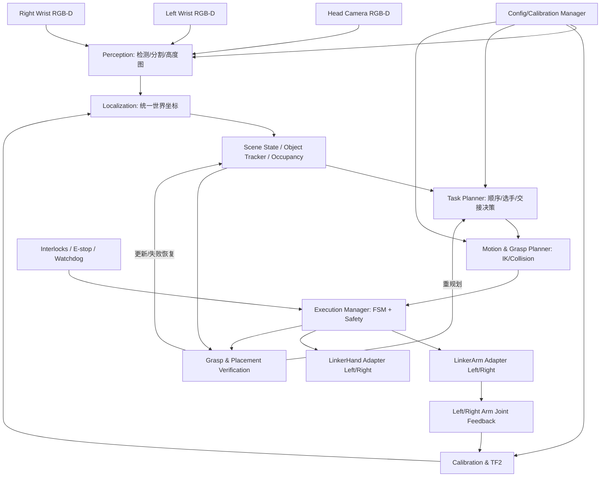
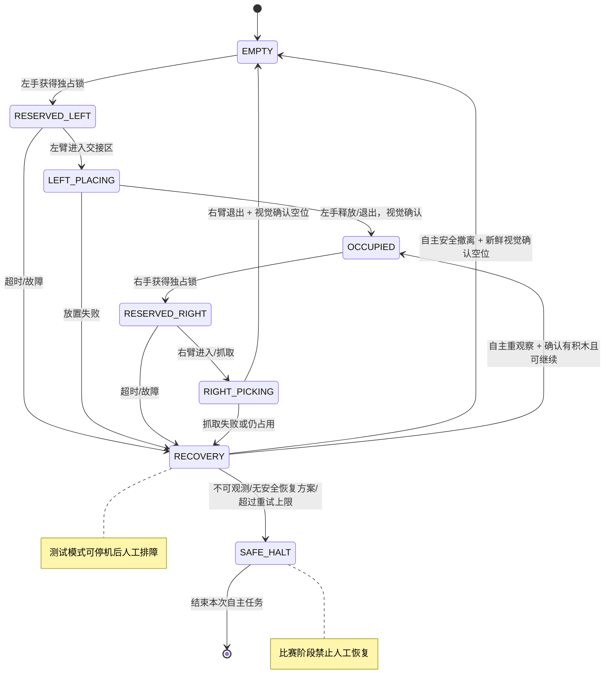

# 全自主双臂灵巧手垒砖砌筑：真机系统设计文档

> **文档用途**：作为 Codex、开发成员和测试成员共享的系统需求与设计基线（Design Baseline）。  
> **项目**：华北五省大学生机器人大赛 · 灵巧手机器人专项赛 · 垒砖砌筑（真机、全自主）。  
> **版本**：v0.2 / 2026-11-05 / 草案（按团队最新真机配置修订）  
> **语言**：中文；Python/ROS 2 符号、类名及 TF frame 名称保留英文。  
> **重要**：此文档是**独立真机项目的设计方案**，不是已通过真机验收的实现。现有 Rabokit 仿真仓库仅可作为经审查的正/反案例资料，**不作为真机工程代码基础、接口事实或验收依据**。带有 `TBD`、`ASSUMPTION`、`PROPOSED` 的项目必须在写硬件控制代码前逐项验证。

---

## 0. Codex 阅读指令（必须先读）

1. **先阅读整份文档**，特别是第 1、3、5、8、12、14 节，不允许只看文件名后直接开始写机械臂运动代码。
2. **不要假定平台或硬件接口，更不能以既有仿真仓库作为真机基线**。当前已有代码属于 Rabokit 仿真平台项目，且并不完整、可靠。新真机项目应独立建仓或隔离目录，从真实硬件需求、官方 SDK、实机验证和本设计出发。仿真代码仅在注明来源、验证适用性后作为正/反案例借鉴；先检查新工程现状、部署环境、官方 SDK 版本及实际 ROS 2 话题/消息定义。
3. 不要捏造设备型号、相机外参、TCP、关节限位、机械臂零位、双臂安装变换、手部动作预设或桌面尺寸。
4. 所有机器人动作默认 `dry_run=true`。**开发测试阶段**：首次真机动作和阶段性测试须经人员授权、低速、清场、急停可用并完成碰撞/限位检查；允许在安全停止后人工介入排障、复位和重新测试。**正式比赛阶段**：在赛前授权及规则允许的启动流程完成后，动作由系统自主执行，过程不得依赖人员逐次确认、手工补位、人工复位或人工修复。两种模式都不得由未验证程序自动标定零点、解除急停或修改电机 Flash；真实硬件安全约束永远优先。
5. 优先实现：**离线/录包测试 → 头部 RGB-D 单臂定位 → 单臂抓放闭环 → 腕部精定位 → 交接区 → 双臂协同**。
6. 将算法与硬件 SDK 解耦。缺少真机时使用 `MockArm`、`MockHand`、`RecordedCamera`；**不得用模拟通过宣称实机成功**。
7. 任何未确认的信息写入 `docs/OPEN_QUESTIONS.md`，不要用默认值掩盖；未知外参禁止启用真机抓取。**参照资料必须标明** `official_sdk` / `real_measured` / `external_reference` / `simulation_example`，不能把 `simulation_example` 记为已验证真机事实。
8. 以 **最小、可测试、可回滚** 的变更提交；每步补充单元测试、集成测试、日志和验收结果。调整坐标约定必须同步修改所有文档与测试。
9. 除非明确指示，**不得编辑第三方 SDK 原始文件**；用适配层、参数文件或上游支持的扩展方式接入。
10. 每次开发汇报至少说明：本次实现、验证方法、测试结果、剩余风险、是否涉及真实硬件动作。

### Codex 的首个任务（在没有真实设备时也可以完成）

- **先确认使用的是新的真机项目仓库**。扫描该真机仓库（若为空则初始化），写 `docs/HARDWARE_INVENTORY.md`、`docs/API_AUDIT.md`、`docs/OPEN_QUESTIONS.md` 和 `docs/SIMULATION_LESSONS.md`（后者仅汇总仿真正/反案例，不导入未审查的控制代码）。
- 检查 `src/`、`launch/`、`config/` 是否已存在，**不要覆盖成员现有代码**。
- 建立基本 Python ROS 2 工作空间、接口数据结构、Mock 和 TF 数学单元测试。
- 若未拿到相机数据，先使用记录图像或合成数据验证识别/投影；若未拿到标定矩阵，禁止把估计坐标发布为可执行目标。
- 输出一个明确的任务清单，未经用户/团队指定**不要擅自连接实体机械臂**。

---

## 1. 背景、目标、范围与假设

### 1.1 任务背景

系统面对桌面供料区中红、黄、蓝、绿等颜色的**约 50 mm 边长漆面木质立方体积木**，通过头部 RGB-D 相机和左右腕部相机识别位置，使用双机械臂和灵巧手自主抓取、必要时在交接区中转、放置至指定搭建区，构成 **4 + 3 + 2 + 1** 的四层立体阶梯/金字塔结构。完成过程中需要实时或事件触发式复检、处理紧密排列、遮挡、失败重试以及不同桌面、光照和高度条件。

### 1.2 已知与暂定信息

| 对象 | 当前信息 | 确认状态 | 开发含义 |
|---|---|---|---|
| 机器人形态 | 立柱式双臂，两端有五指灵巧手 | 用户提供外观参考照片；具体装配待测 | 必须建立独立左右臂根坐标及整机公共坐标系 |
| 机械臂 | LinkerArm；**P7 作为当前适配候选** | `TBD` 最终型号、固件、安装方向 | P7 SDK 方案仅在型号核实后启用 |
| 灵巧手 | LinkerHand O6（两只） | 预期型号，待核验硬件版本和触觉选配 | 六主动控制通道；不能假定有触觉反馈 |
| 头部相机 | Orbbec Gemini 335L | 计划型号；设备序列号待确认 | 全局 RGB-D 扫描与结构复检 |
| 左/右腕相机 | **Orbbec Gemini 335（两台）** | 型号已由团队确认；序列号、固件、安装位姿仍待核验 | 与头部 335L 统一抽象接口，但左右两机内外参、深度尺度、序列号必须各自独立 |
| 积木 | **边长约 50 mm 的漆面木质正方体** | 按团队本次实物信息更新；最终边长、质量、漆面材质须实测 | 硬质表面、可能存在反光及滑移；需校验实际尺寸、抓握摩擦和边角损伤风险 |
| 结构 | 4/3/2/1 共 10 块，按比赛要求的颜色和层序 | 目标结构，详细方向以官方规则确认 | 支撑关系决定放置顺序 |
| 比赛约束 | 曾讨论 5 分钟操作时限、XY 20 mm / Z 15 mm 判定范围 | `TBD`：请以最新正式规则核验 | 内部定位/放置目标应比规则容差更严格 |
| 软件 | ROS 2 + Python + OpenCV + Orbbec SDK + Linkerbot SDK | `PROPOSED` | 优先 Ubuntu 22.04/Humble 或 24.04/Jazzy，最终统一版本 |
| 运动规划 | LinkerArm 自有运动学 + 规划/碰撞层（MoveIt 2 候选） | `PROPOSED` | 设备 SDK **不等于**双臂避碰规划器 |

### 1.3 成功标准

**最终目标**：在正式规则规定的时间内，**不依赖比赛过程中的人工干预**，自主完成尽可能多且位置正确、稳定的目标积木；对异常执行可验证、有界的自动重观察/重抓/重放/重规划；**没有安全可行恢复方案时进入安全停止或其他规则允许的终止状态**，而不是等待人员补救。优先保证可靠与安全，再优化速度。

**测试与正式比赛边界**：开发测试可在停止后由人员摆放积木、修复环境或复位设备并重新试验；这些是 `TEST_ASSISTED`，不能计入“全自主成功”。正式比赛采用 `COMPETITION_AUTONOMOUS`，禁止人工介入/手动恢复；故障处理能力应通过离线、仿真和安全真机试验分别验收。

**阶段性目标**：

- G1：头部相机在不同位置识别**多块同色积木实例**，输出各自 3D 位姿和质量标记。
- G2：相机坐标经验证变换到统一 `world`，单臂在安全高度重复对准随机积木。
- G3：单臂单手完成抓取、释放和视觉复检；在有新鲜视觉/关节数据且安全条件满足时自动有限次重试，否则安全终止。
- G4：识别放置偏差、分层高度和支撑关系，实施**释放前**位置微调。
- G5：当直达不可行时，执行带互斥锁的交接区双臂转运。
- G6：完整 4+3+2+1 任务，区分 `TEST_ASSISTED` 与 `COMPETITION_AUTONOMOUS`，分别记录无人工成功率、误差、耗时、自主恢复成功率及安全终止次数。

### 1.4 非目标（第一版不做）

- 端到端强化学习、VLA/LLM 直接输出低层关节命令；
- 三台相机每帧稠密融合为一个全局点云；
- 双臂一开始就完全并发；
- 未经过验证的释放后推挪积木；
- 不做风险检查的直接发布关节控制指令；
- 假设密接同色立方体一定可由单视角可靠分离。

---

## 2. 总体功能架构



### 2.1 模块职责边界

| 模块 | 输入 | 输出 | **不负责** |
|---|---|---|---|
| Camera Adapter | Orbbec 图像、内参、时间戳 | 统一 RGB、对齐深度、CameraInfo | 识别积木、变更机器人运动 |
| Perception | RGB-D、ROI、相机参数 | 多实例检测、顶面/侧面特征、质量分 | 输出机械臂动作 |
| Localization | 2D/3D 观测、标定、时间戳 TF | `world` 下物体位姿及不确定度 | 自行修改标定 |
| Scene Manager | 观测、动作事件、已知几何 | object IDs、堆叠格、占用、遮挡/未知 | 直接驱动电机 |
| Task Planner | 场景、目标结构、可达性 | 任务计划：抓取/交接/放置 | 输出底层 CAN 帧 |
| Motion/Grasp Planner | 目标位姿、URDF、障碍、关节状态 | 安全路径、抓取/释放姿态 | 认为求得 IK 就代表无碰撞 |
| Execution Manager | 计划、驱动反馈、视觉确认 | 状态机事件和动作执行 | 在无新鲜反馈时继续运行 |
| Verification | 检测、目标、历史状态 | OK/ADJUST/RETRY/UNKNOWN | 把不可见积木直接标为失败 |
| Hardware Adapters | 官方 SDK / ROS 2 驱动 | 设备状态、受控命令 | 默认使能、自动回零、绕过安全检查 |
| Configuration Manager | YAML、标定版本 | 版本化参数与运行时快照 | 静默热更新外参和限位 |

### 2.2 工程原则

- **相机无关**：业务逻辑不写死 Gemini 某一型号；不同相机各用独立参数和内参。
- **坐标单一真相源**：跨臂比较统一使用 `world`，严禁混用左/右臂 SDK 自身根坐标。
- **状态来源明确**：感知结果是观测；实际执行和支撑信息是经过验证的状态，二者不可混用。
- **不确定性显式传递**：检测有 confidence 和 covariance/质量分；低可靠观测必须拒绝或主动复看。
- **分层部署**：视觉算法可脱机复现；动作逻辑可在 Mock 中模拟；最后才进入实机。
- **仿真隔离**：旧 Rabokit 项目仅作为可审计的正/反案例，不作为新真机代码基础。新工程依赖官方 SDK、真机观测与正式需求。
- **自主性分级**：人工辅助调试结果与完全自主运行结果分开计数，比赛任务内不允许人为解锁或替机器人决定下一动作。

---

## 3. 坐标系和标定规范（P0）

### 3.1 统一命名及单位

- `world`：整机公共参考坐标系，原点及轴向通过整机安装决定；**不能直接等同左臂或右臂 SDK 根坐标**。
- `table`：桌面平面参考系（Z=0 为桌面上表面，Z 轴为桌面法线）。
- `head_camera_color_optical_frame`、`head_camera_depth_optical_frame`。
- `left_arm_base`、`right_arm_base`。
- `left_flange`、`right_flange`；`left_grasp_tcp`、`right_grasp_tcp`。
- `left_wrist_camera_color_optical_frame`、`right_wrist_camera_color_optical_frame`。
- `block/<id>`：检测/跟踪物体坐标系；`target/<slot_id>`：目标格坐标系。
- **坐标单位**：m，**角度**：rad，**时间**：ROS header 时间戳；相机像素以 `(u, v)` 表示。
- 约定 `T_A_B` 将 **B 坐标系中的点/位姿变换到 A 坐标系**；4×4 矩阵列向量左乘，组合 `T_A_C = T_A_B @ T_B_C`。

### 3.2 正确的 TF 结构

```text
world
├── table                        # 静态或重新标定后更新
├── head_mount -> head_camera_* # 头部固定时静态；若头/升降机构可动则动态
├── left_arm_base                # 机械安装变换，需实测
│   └── left_arm_link_1 ... left_flange     # 动态 FK(q_left)
│       ├── left_grasp_tcp       # 手/工具标定
│       ├── left_hand_palm -> fingers ...
│       └── left_wrist_camera_*  # Eye-in-Hand 外参
└── right_arm_base               # 机械安装变换，需实测
    └── right_arm_link_1 ... right_flange
        ├── right_grasp_tcp
        ├── right_hand_palm -> fingers ...
        └── right_wrist_camera_*
```

> 此为**逻辑树**，实际 parent/child 必须匹配 URDF、Orbbec 驱动的 optical frame 与 `robot_state_publisher`；不能创建重复发布同名 TF 的冲突树。物体可作为场景状态单独发布动态 TF，不应重复设置多个 parent。

### 3.3 三类标定

**A. 相机内参**：分别读取/验证各相机 `K`、畸变、RGB 与 Depth 外参、深度尺度、对齐方式。调整分辨率/裁剪模式后重新确认内参。**不同同系列相机不得共享标定文件。**

**B. Head（Eye-to-Hand/固定相机外参）**：标定 `T_world_head_camera`。若头部相机安装在可动升降杆上，需要动态机构模型/传感；不能按静态处理。

**C. 左/右腕 Eye-in-Hand**：分别标定 `T_left_flange_left_camera` 和 `T_right_flange_right_camera`。采集多组具有**平移与旋转多样性**的机械臂姿态，同时记录标定板的相机观测和相应时刻的机械臂关节反馈；多组求解后做独立验证。

**D. 工具/双臂安装几何（不能漏）**：`T_world_left_arm_base`、`T_world_right_arm_base`、`T_flange_grasp_tcp` 和**积木相对抓取点**的变换。左右独立标定并检查是否与实际姿态一致。

### 3.4 坐标计算

头部观测：

`T_world_block = T_world_head_cam × T_head_cam_block`

左腕观测：

`T_world_block = T_world_left_arm_base × T_left_arm_base_left_flange(q,t) × T_left_flange_left_cam × T_left_cam_block`

右腕同理。

RGB 像素、深度投影到相机 optical frame（无畸变/已对齐的像素前提）：

```python
Xc = (u - cx) * depth_m / fx
Yc = (v - cy) * depth_m / fy
Zc = depth_m
p_world = T_world_camera @ np.array([Xc, Yc, Zc, 1.0])
```

**注意**：这通常是可见表面点，不自动等于积木几何中心。应通过顶面平面、**实测约 50 mm 的几何尺寸**、姿态及桌面法向恢复中心；深度 0 值、NaN、反光点和边界离群点必须过滤。

**放置前 TCP 目标**：`T_world_tcp_target = T_world_block_target × inverse(T_tcp_block_held)`。其中 `T_tcp_block_held` 需要在抓取后通过标定/视觉估计，否则 TCP 偏移会直接成为放置偏差。

### 3.5 时间戳与多相机

- 腕相机图像对应**拍摄时刻**的关节位置与 TF，而不是任意调用时的 latest TF。
- 同一相机 RGB / depth 应做时间同步、深度向 RGB 对齐或明确使用原生坐标和外参；不能混用未经配准的 `(u,v)`。
- 三相机**无需一开始硬件同步采集**：采用事件驱动的头部扫描和腕部局部扫描。但每次观测必须有有效时间戳，使用近似/精确同步的具体策略在实测后决定。
- 加入 `tf_stale`、`image_stale`、`joint_state_stale` 检查；超时后不执行运动。

### 3.6 标定验收建议

- 多个桌面点、多个高度、工作区边缘点，测量 **XY 绝对误差、Z 绝对误差、重复性、P95**。
- 不只报告重投影误差（pixel RMS）；还要报告物理世界的 mm 误差。
- 以正式规则容差为最终边界，内部建议初期追求平面定位 P95 < 10 mm、高度定位 P95 < 8 mm（**研发建议值，待实测调整；并非设备保证**）。
- 如果相机固定件、机械臂基座或灵巧手 TCP 改变，标记 calibration invalid，重新验证相关变换。

---

## 4. 视觉感知与紧贴积木分割（P0）

### 4.1 输入/输出

输入：同步彩色图、有效深度图、`CameraInfo`、对应 TF、供料/搭建 ROI、已知尺寸及上一轮 Scene State。

每个候选输出建议：

```yaml
id: 'block_007'                # 仅在追踪稳定后赋予持久 ID
color: 'red'                 # red/yellow/blue/green/unknown
camera_id: 'head'            # head/left_wrist/right_wrist
frame_id: 'world'
stamp: '... ROS time ...'
pose_world: {position_m: [0.0, 0.0, 0.0], orientation_xyzw: [0, 0, 0, 1]}
size_m: [0.05, 0.05, 0.05]  # 约50mm先验；以实测为准，记录来源
confidence: 0.0
covariance: null             # 可选：需注明矩阵格式与单位
visible_faces: ['top']
segmentation_status: 'UNAMBIGUOUS' # /AMBIGUOUS/OCCLUDED/INVALID_DEPTH
pickability: 'UNKNOWN'       # 由抓取规划综合判断
```

### 4.2 算法第一版：颜色 + 几何 + 深度

1. 相机驱动输出 RGB、depth、内参与时间戳。
2. 建立桌面点云并用 RANSAC 等方法估计桌面平面 `ax+by+cz+d=0`；基于法向计算高度图 `height_above_table`。
3. 选择供料区 ROI，分别做 HSV 颜色分割。对 RGB 图像做有限度亮度/白平衡控制，记录环境 profile。
4. 结合高度阈值排除桌面背景；做形态学开闭运算，但避免过度滤波抹掉紧密接缝。
5. 对各颜色候选区域检测轮廓、直线、角点、`minAreaRect`，对独立轮廓直接拟合。
6. **同色紧贴/同高**时，利用距离变换 + Watershed、边缘/角点、立方体约 50 mm 的尺寸先验（以实测为准）、网格模型以及多视角/历史状态去拆分；提供 `AMBIGUOUS` 状态。
7. 为每个实例估计中心 `(x,y,z)`、水平旋转、尺寸和不确定度；通过时序跟踪分配稳定 ID。
8. 如果检测不可信，执行 `ACTIVE_REOBSERVE`：移动腕部到安全观察位，或者先抓取一个显然可达的外侧积木以暴露遮挡。

**不可辨识边界**：完全同色、同高、无接缝、无纹理、无任何可见几何差异的贴合立方体，对单张 RGB-D 图像可能无解。必须把“不可区分”作为算法允许的输出，而不是编造多个中心。

### 4.3 高度图（Heightmap）

- 先估计桌面平面，再把点云变换到 `table`；按 `(x,y)` 网格栅格化为最大/稳健高度。
- 在供料区，区分单块顶面和桌面背景；在搭建区，用于检查分层表面与预期结构是否匹配。
- 对近距离深度不可用、透明/反光/暗色、夹爪遮挡区域，保留 `unknown` mask，不做虚假插值。
- 漆面木块具有相对较高的刚度，但**油漆反光、边缘倒角、实际尺寸公差、块间缝隙和底板平整度**仍会造成测高误差；层高使用 0.05m 理论值 + 实测修正，绝不将假定尺寸当作测量真值。

### 4.4 场景追踪

- 不能仅靠颜色当 ID：四块红色积木属于四个不同实体。
- 用位置、颜色、形状、深度及历史动作追踪数据关联。
- 物体可处于 `SUPPLY`、`HELD_LEFT`、`HELD_RIGHT`、`HANDOFF`、`PLACED`、`OCCLUDED`、`UNKNOWN`。
- 被遮挡不等于消失；抓取动作完成后需用观测/手部反馈验证状态变更。

### 4.5 视觉环境鲁棒性

| 干扰 | 第一版处理 | 验证方式 |
|---|---|---|
| 不同室内光照/色温 | 颜色 profile、曝光/白平衡稳定化、结合深度 | 三档照明×多颜色 |
| 桌面颜色与积木相同 | 桌面平面分离 + ROI + 几何边界 | 同色桌布/背景 |
| 桌面高度/倾角变化 | 拟合桌面并更新 `table` | 抬高/倾斜已知量后复测 |
| 同色紧贴 | 分水岭+边缘+尺寸先验+多视角 | 2～4 块接触实验 |
| 多层遮挡 | 状态记忆 + 可见性模型 + 侧视复检 | 遮挡底层目标 |
| 深度盲区/失真 | 有效深度比例/距离门控 | 不同距离实测 |
| **漆面木块反光/高光** | 结合 RGB 边缘、深度有效率、斜视角和多帧稳健估计，避免高光处盲信单点深度 | 不同入射角、光源方向、漆面颜色 |
| 三相机 USB/光学干扰 | 各自 namespaces/serials，必要时分时采集 | 同时开机掉帧与深度质量 |

---

## 5. 目标建模与三维结构验证（P0）

### 5.1 目标几何与顺序

以最终官方结构为准，初版使用 4+3+2+1 共 10 个目标槽位，槽位编码 `L0_0..L0_3`、`L1_0..L1_2`、`L2_0..L2_1`、`L3_0`。**按当前已知的约 50 mm 漆面木质立方体**，下面仅给出无间隙、未倾斜、X 方向居中摆放的理论几何中心位置：

| 层（自 0） | X 相对偏移（m） | 理论中心高度（m） | 先决条件 |
|---|---|---|---|
| L0（4块） | -0.075, -0.025, +0.025, +0.075 | 0.025 | 桌面支撑 |
| L1（3块） | -0.050, 0, +0.050 | 0.075 | 对应两块底层稳定 |
| L2（2块） | -0.025, +0.025 | 0.125 | 对应两块 L1 稳定 |
| L3（1块） | 0 | 0.175 | 两块 L2 稳定 |

一般化：若实测边长为 `a`，第 `layer` 层有 `n` 块，第 `i` 块中心 `x = (i - (n-1)/2)*a`、`z=(layer+0.5)*a`（均相对于 `table`，`i=0..n-1`）；`y` 由目标排布及官方规则确定。**禁止把上表硬编码到路径规划器，必须按实测 `measured_edge_m` 动态生成槽位**。

> **注意**：以上是示范目标模型，不代表已经核验的正式比赛要求。实际边长、底板高度、油漆层/倒角、公差、积木间隙、支撑接触、颜色顺序与验收容差都须以实物和现行规则确认。

### 5.2 目标模型 = 槽位 + 支撑依赖

```python
Slot = {
  'slot_id': 'L1_0', 'layer': 1, 'required_color': 'yellow',
  'target_pose_in_table': ..., 'supports': ['L0_0', 'L0_1'],
  'state': 'EMPTY' # RESERVED/PLACED_VERIFIED/UNVERIFIED/FAILED
}
```

任务规划必须满足：上层放置前，其下层支撑槽位均为 `PLACED_VERIFIED`。同层内部由路径、可达性和后续遮挡风险决定顺序。

### 5.3 放置前、中、后的验证

**放置前**：目标槽没有障碍；支撑已验证；抓取积木颜色与目标一致；碰撞检查通过。

**放置中/释放前**：目标积木位姿已尽可能接近目标；视觉或几何估计掌握其相对 TCP 偏移；必要时做小步修正。

**放置后（手撤离）**：头部 RGB-D/必要时腕部侧视对比：

- 平面误差 `e_xy = hypot(x_obs-x_target, y_obs-y_target)`。
- 高度误差 `e_z = abs(z_obs-z_target)`。
- 方向误差需要处理立方体 90° 旋转对称性，必要时估计 roll/pitch 倾斜。
- 高度图与目标层占用区域的一致性；相邻接触与支撑覆盖程度。
- 积木在最终释放、撤离后可见状态持续保持稳定；以正式规则要求的静置时长验证，前期讨论约 3s，须核验。对漆面木块重点关注滑动、翘角、接触面错位和边缘碰撞。

**验证结果**建议枚举：`PASS / ADJUST_BEFORE_RELEASE / REGRASP / UNOBSERVABLE / FAIL_SAFE`。底层被上层遮挡时保留历史状态并标记观测不完整，禁止将不可见等同于失败或成功。

### 5.4 误差阈值分层

- `detection_quality_threshold`：检测可信程度；
- `pre_grasp_position_tol`：末端可进入抓取的误差门槛；
- `pre_release_refine_tol`：释放前微调目标；
- `placement_xy/z_tol`：放置合格阈值；
- `safety_clearance`：安全余量，**不能与允许定位误差混为一谈**。

阈值先以**保守的建议值**设置并允许版本化调整；要通过实测数据确定最终数值。超过容差不自动发出推积木指令。

---

## 6. 双臂可达性、交接区与任务调度（P1）

### 6.1 先测可达性，再决定是否交接

对左右臂分别计算：给定抓取/释放 TCP 姿态是否有可行 IK、完整接近/抬升路径、碰撞余量和退出路径。可达性是位姿集合，不仅是 XY 圆形覆盖区。

- `DIRECT_RIGHT`：右臂可从供应区直接抓取并安全放入目标。
- `DIRECT_LEFT`：左臂可直接完成目标操作（如果比赛及安装允许）。
- `HANDOFF_L_TO_R`：只有左臂易于抓取、右臂适合搭建时经交接区转运。
- `UNREACHABLE`：所有方案无效，重新规划或安全停止。

### 6.2 交接区约束

- 在左/右臂均能**完成整套安全抓放**的工作空间交集选择区域，不仅是数学交集点。
- 允许单块积木；交接槽位需要记录 `occupied_by_id`、位姿、颜色、检测时间戳。
- **共享空间互斥**：交接区只允许一只机械臂持有 lease；未释放 lease 的手臂禁止另一臂进入。
- 只有视觉确认为空且右手已撤离，交接槽才能回到 `EMPTY`；“发送抓取命令成功”不足以证明已空。
- **开发测试**：交接失败后可以安全停止，由人员排障、重新摆放或重启试验，日志标记 `TEST_ASSISTED`。**正式比赛**：不得人工处理，`RecoveryManager` 必须自主重新观察，检查交接位占用与双方是否撤离，尝试**有限次且可规划的**重新抓取/退让/再放置；无法安全验证或数据过期时进入 `SAFE_HALT`，不盲目继续。

### 6.3 交接区 FSM



**重要**：不能在异常路径中无条件释放所有区域锁。先安全停车、收集新观测，再由 Recovery Manager 重建事实状态。

### 6.4 规划成本

`cost = w_time * time_est + w_risk * failure_risk + w_handoff * handoff_count + w_occlusion * future_occlusion`。

硬约束高于成本：合法支撑、手臂限位、路径可达、碰撞安全、交接互斥、图像/关节状态有效。初版使用保守规则，后续用日志估计成本权重。

### 6.5 双臂并发策略

- **V1**：只用一臂操作，另一臂停在可验证的安全姿态。
- **V2**：交接时**串行**（左放完并退出 → 右抓走并退出）。
- **V3**：在严格区域划分和全机避碰确认后，允许左臂在专属区域准备下一块，右臂在搭建区放置；交接区本身始终单持有者。

---

## 7. 放置前微调与释放后修正（P1/P2）

### 7.1 首选：抓着积木时修正

1. 机械臂携带积木到目标上方安全高度。
2. 头部或腕部相机获取目标积木**本体**的最新位姿（不仅是 TCP）。
3. 计算相对目标位姿误差；判断图像质量与碰撞风险。
4. 以限速、小步的安全位姿增量更新 TCP，重复观测直到收敛或达到次数/时间上限。
5. 垂直下降、确认支撑/接触条件后释放，撤离复检。

若积木完全被手掌遮挡，使用抓取时记录的相对抓取变换与 FK 预测，但必须显式降低置信度；不能假设夹持过程中永不滑动。

### 7.2 释放后修正

优先级：`接受合格 → 安全重抓再放 → 任务重规划 → 放弃/停机`。**首次版本禁用直接侧向推挪**。以后若要实现 `post_release_push`，须独立评估：**漆面木块的摩擦/滑移、边角破损、相邻结构影响、指尖接触、力控制**、碰撞与二次验证；不沿用软质积木的形变假设。

---

## 8. 机器人运动与控制接口（安全关键）

### 8.1 Hardware Adapter 契约（项目自定义，不是官方 API 原名）

```python
class ArmAdapter(Protocol):
    def get_joint_state(self) -> JointState: ...
    def get_tcp_pose(self, frame: str) -> PoseStamped: ...
    def plan_to_pose(self, target: PoseStamped) -> PlanResult: ...
    def execute_approved_plan(self, plan_id: str) -> ExecutionResult: ...
    def stop(self) -> None: ...

class HandAdapter(Protocol):
    def get_state(self) -> HandState: ...
    def set_preset(self, name: str, speed_limit: float) -> ExecutionResult: ...
    def stop(self) -> None: ...

class CameraAdapter(Protocol):
    def get_synced_rgbd(self) -> RGBDObservation: ...
```

- `ArmAdapter` 中的 `plan_to_pose` 调用规划层，不是直接调用底层电机 API。
- 硬件执行必须通过 `SafetyGate` 检查最新 joint state、TF、场景障碍和共享区域 lease。
- 每个执行结果记录命令 ID、计划 ID、目标与实测状态、开始/完成时间、超时和中断原因。

### 8.2 LinkerArm 现有官方接口（已在源码文档核对）

- 官方 Python SDK [`linkerbot-arm-python-sdk`](https://github.com/linker-bot/linkerbot-arm-python-sdk) 的 P7 模型提供 `get_angles()`, `get_pose()`, FK/IK, `move_j()`, `move_p()`, `move_l()`（**型号及安装需核实**）。
- 官方 ROS 2 SDK [`linkerbot-arm-ros2-sdk`](https://github.com/linker-bot/linkerbot-arm-ros2-sdk) 默认发布 `/left_arm_joint_state`、`/right_arm_joint_state`，接收 `/left_arm_joint_control`、`/right_arm_joint_control`，消息类型为 `sensor_msgs/msg/JointState`。左臂关节名 `61..67`，右臂 `51..57`，单位 rad。
- **重要**：这些控制话题是关节目标，不是 `FollowJointTrajectory` Action；SDK 内置的运动学/轨迹发送不负责完整双臂/桌面积木碰撞检测。接入 MoveIt 2 需要自行设计并验证轨迹执行 adapter/controller。
- P7 左右 URDF 默认各自以本臂根关节为原点，**并不包含双臂之间的实际安装变换**。
- `move_p()` 的轨迹不保证末端为直线；`move_l()` 规划末端直线但仍需外部碰撞与风险检查。
- ROS 2 SDK 的某些启动配置默认 `auto_enable: true`；**首次真机必须显式关闭**，不要自动回零。P7 SDK 初始化还可能检查并写入特定电机控制模式，必须按硬件手册在授权环境中进行。

### 8.3 LinkerHand O6（版本需核对）

- 官方旧版 [`linkerhand-ros2-sdk`](https://github.com/linker-bot/linkerhand-ros2-sdk) 提供 `/cb_left_hand_control_cmd`、`/cb_right_hand_control_cmd`、对应 state 话题；部分接口使用 0–255 的 6 通道原始值、也有角度接口。**实际运行时以所安装版本及 `ros2 topic info -v` 为准**。
- O6 六个主动控制通道：拇指弯曲/侧摆、食指、中指、无名指、小指弯曲。
- O6 URDF：[`linkerhand-urdf/O6`](https://github.com/linker-bot/linkerhand-urdf/tree/main/O6)；应核对左右手模型和硬件接口对应关系。
- 触觉是条件能力：只有设备确有传感器、驱动输出新鲜可靠数据时才启用触觉验证，否则使用视觉和关节状态结合。
- 不直接把 0–255 映射成任意弧度；动作预设由实机安全试验获取。
- 还应检查是否改用厂商更新的 `linkerbot-hand-ros2-sdk`：不同仓库的控制接口可能不同，**不能混用文档**。

### 8.4 Orbbec Gemini（待确认各相机型号）

- ROS 2 官方驱动：[`OrbbecSDK_ROS2` v2-main](https://github.com/orbbec/OrbbecSDK_ROS2/tree/v2-main)。
- 三台相机分别使用 `camera_name`、`serial_number` 和独立 ROS namespace；每台相机读取实际 CameraInfo、深度尺度、启动 profile。
- 在所用型号和分辨率下验证 `depth_registration`、深度输出坐标、分辨率与同步状态。
- Gemini 系列有**型号相关**的最近有效深度、FOV、镜头参数；腕部精定位需通过实际工作距离测试确认，不要按头部相机量程直接套用。

### 8.5 安全门控（不可跳过）

任一条件不满足则本次动作不执行：

- `dry_run == false` 且已获得明确的真机授权；
- 物理急停可用、操作人员在场、机械臂工作区已清空无关人员；
- 标定文件已验证且未过期，坐标系一致；
- ROS joint state、相机数据、TF 在各自允许时间窗内；
- 规划姿态满足关节限位、TCP、工作空间、障碍物与双臂碰撞检查；
- 实体设备处于允许运动的状态；
- 相关区域 lease 获得成功，其他手臂已处安全姿态；
- 命令速度、加速度、位移、超时和重试次数符合参数限制。

**开发测试阶段**允许经安全授权的人工触发单步、停机排障和重新测试；必须标记 `TEST_ASSISTED`。**正式比赛阶段**在赛前安全确认及合法启动信号后进入 `COMPETITION_AUTONOMOUS`，不得在每个动作前等待人工点击确认，也不得要求现场人员干预恢复。所有动作仍必须经自动安全门控；没有安全可行的动作或反馈失效时进入 `SAFE_HALT`。

### 8.6 运行模式与异常处理边界

| 模式 | 人员行为 | 允许恢复策略 | 验收统计 |
|---|---|---|---|
| `DEVELOPMENT_TEST` | 有人在场并可在安全停止后人工调整、重新标定、复位 | 手动恢复 + 有限自动恢复，逐步验证 | `TEST_ASSISTED` 单独记录，不计入无人自主成功率 |
| `AUTONOMY_TRIAL` | 受控试验中允许安全监护与必要时急停，但不参与正常任务决策 | 正常流程必须自动恢复；人工介入则该次判定不自主成功 | 记录 autonomous/assisted 分类 |
| `COMPETITION_AUTONOMOUS` | 赛前授权和规定启动后，比赛中不允许人工介入；安全急停作为保护手段，不作为恢复手段 | 自主重观察、有限次数重试、替代路线、规则允许时跳过；否则 `SAFE_HALT` | 仅无人工干预的结果计入比赛自主统计 |

> **自主恢复不等于保证恢复成功**。`AUTO_RETRY` 只有在新鲜图像/TF/关节数据、可达性、障碍与碰撞检查、交接区占用状态均重新确认后才允许。未知障碍、急停、硬件故障、TF 失效等状态不能靠无限循环或盲目复位解决。人工干预后应显式重新初始化并重新评估场景，不能直接从中断指令继续。

---

## 9. 任务状态机与完整工作流

### 9.1 系统级 FSM

```text
INIT → SELF_TEST → CALIBRATION_CHECK → READY
READY → GLOBAL_SCAN → SCENE_UPDATE → PLAN_TASK
PLAN_TASK → (DIRECT_PICK | HANDOFF_LEFT_TO_RIGHT | NO_SAFE_ACTION)
DIRECT_PICK / HANDOFF... → PRE_GRASP → WRIST_REFINE → GRASP → GRASP_VERIFY
GRASP_VERIFY[PASS] → TRANSPORT → PRE_PLACE_REFINE → PLACE → RETREAT
PLACE → PLACEMENT_VERIFY → SCENE_UPDATE → PLAN_TASK
GRASP_VERIFY/PLACEMENT_VERIFY[FAIL] → CLASSIFY_FAILURE → REOBSERVE → CHECK_SAFE_RECOVERY
CHECK_SAFE_RECOVERY[YES] → BOUNDED_AUTO_RETRY / ALTERNATE_PLAN → PLAN_TASK
CHECK_SAFE_RECOVERY[NO] → SAFE_HALT（测试模式可由人员停机排障；比赛中不人工恢复）
NO_SAFE_ACTION / ESTOP / STALE_FEEDBACK → SAFE_HALT（停用可能不安全的运动；不能盲目撤离）
所有目标验证完成 → FINAL_STABILITY_CHECK → DONE
```

### 9.2 一块积木典型事务（原子边界）

1. 读取**同一版本**配置、标定、当前 scene snapshot。
2. 选择 `block_id` 和 `slot_id`，检查颜色、支撑与可达性。
3. 选择 `DIRECT_LEFT / DIRECT_RIGHT / HANDOFF_L_TO_R`。
4. 生成抓取候选；进行碰撞/关节限位检查；锁定本次任务资源。
5. 头部或腕部重新观察；执行 `APPROACH → GRASP → LIFT`。
6. 视觉/状态确认确实抓起；否则安全撤离重扫。
7. 如交接，按 Handoff FSM 完成中转并转移 `held_by` 所有权。
8. 生成目标 slot 的末端位姿，先到安全高度，执行放置前微调。
9. 缓慢放置、释放、退出；视觉复检和结构稳定性检查。
10. 只在验证通过后**提交** `slot=PLACED_VERIFIED`；记录事务日志。失败要有可恢复的中间状态。

### 9.3 事务原则

- **规划成功 != 执行成功 != 视觉验证成功**。
- 不可观测的结果标记 `UNKNOWN` 并进入重观察，不直接当作 PASS。
- 单个 slot 和 block 同一时刻只允许一个 active operation，支持幂等重复调用。
- 如果断电/进程重启，先重新扫描并重建 Scene State，不直接从旧动作索引继续运动。
- **失败处理优先级**：新鲜观测 → 判断是否可安全自动恢复 → 有界重试或替代路线 → 无法恢复则安全终止；比赛模式不产生 `WAIT_FOR_HUMAN` 状态。
- 每次尝试必须记录 `manual_intervention_count`、`recovery_attempts`、`recovery_outcome` 和运行模式；只有 `manual_intervention_count=0` 的有效完成才算自主成功。

---

## 10. 配置管理、数据记录与可观测性（P0）

### 10.1 配置分层

- `config/default.yaml`：不涉及硬件个体的通用算法默认。
- `config/competition.yaml`：规则、slot、颜色、时间限制、任务策略。
- `config/operation_modes.yaml`：开发测试/自主试验/正式比赛的人工介入和自主恢复权限；比赛模式强制拒绝任何人工恢复依赖。
- `config/robots/<robot_serial>.yaml`：设备型号、CAN 接口、安装根坐标、关节驱动版本。
- `config/cameras/<serial>.yaml`：型号、namespace、stream 配置、内参来源、RGB-D 对齐设置。
- `calibration/<setup_version>/...`：**版本化**的头部/腕部/双臂/TCP 标定，附验证报告和采集时间。
- `config/profiles/<lighting_profile>.yaml`：HSV、深度滤波、曝光建议及识别阈值。

### 10.2 推荐示例配置（非真机参数）

```yaml
project:
  name: brick_stacking
  dry_run: true              # 默认绝不发送实体运动
  environment: offline      # offline/sim/real，旧 Rabokit 仿真不得作为真机基线
  ros_distro: TBD

operation:
  mode: DEVELOPMENT_TEST     # DEVELOPMENT_TEST/AUTONOMY_TRIAL/COMPETITION_AUTONOMOUS
  manual_intervention_allowed: true   # 比赛模式必须为 false；由配置校验器强制约束
  require_preflight_authorization: true

frames:
  world: world
  table: table
  left_arm_base: left_arm_base
  right_arm_base: right_arm_base

cameras:
  head: {model: 'Gemini 335L (planned)', serial: TBD, namespace: /head_camera, role: global}
  left_wrist: {model: 'Gemini 335', serial: TBD, namespace: /left_wrist_camera, role: refine}
  right_wrist: {model: 'Gemini 335', serial: TBD, namespace: /right_wrist_camera, role: refine}

blocks:
  material: painted_wood
  finish: lacquered
  nominal_edge_m: 0.050
  measured_edge_m: null
  colors: [red, yellow, blue, green]

competition:
  layers: [4, 3, 2, 1]
  task_timeout_s: null        # 以最新规则填入
  required_colors_by_layer: [red, yellow, blue, green]  # 待最终规则核验

perception:
  hsv_profile: indoor_default
  min_valid_depth_ratio: 0.65 # 建议起点；需验证
  min_detection_confidence: 0.75
  multi_frame_window: 15
  reject_ambiguous_instances: true

localization:
  tf_timeout_s: 0.2
  max_image_age_s: 0.5
  max_joint_age_s: 0.2
  require_valid_calibration: true

verification:
  xy_tolerance_m: 0.010      # 内部建议，非官方容差
  z_tolerance_m: 0.008
  stable_hold_s: 3.0         # 以比赛规则核对
  verify_each_layer: true

handoff:
  enabled: false             # 完成可达性评估后才启用
  max_slots: 1
  require_visual_empty: true
  allow_parallel_entry: false

recovery:
  enable_bounded_auto_recovery: true
  max_grasp_retries: 2
  max_place_retries: 1
  max_handoff_retries: 1
  on_unrecoverable: SAFE_HALT
  allow_post_release_push: false

safety:
  preflight_operator_authorization_required: true  # 赛前/测试授权，不是每次动作人工确认
  max_real_tcp_speed_mps: null   # 未测量/审核前不得给出假数值
  require_collision_check: true
```

### 10.3 参数热更新规则

**可在安全任务边界更新**：颜色阈值、检测置信度、调试 ROI、扫描帧数、重试策略、非安全相关日志级别；更新后记录版本。**比赛模式的人工介入禁令不可被热更新解除**。

**不允许静默热更新**：相机外参、双臂安装位姿、TCP、关节限位、速度/加速度安全上限、碰撞模型、真实硬件启用状态、`operation.mode`。变化必须停机、校验并重新加载配置。配置加载时强制验证 `COMPETITION_AUTONOMOUS ⇒ manual_intervention_allowed=false`，并拒绝无法自主运行的交接/恢复工作流。

### 10.4 日志与数据集

每次实验保存：

```text
runs/YYYYMMDD_HHMMSS_runid/
  config_snapshot.yaml
  calibration_hashes.json
  camera_head/           # RGB/depth 或 rosbag2
  camera_left_wrist/
  camera_right_wrist/
  tf_and_joint_states/   # 保留时间戳
  detections.jsonl
  scene_events.jsonl
  motion_plans.jsonl
  execution_events.jsonl
  validation_report.json
  metrics.csv
```

记录每一步：来源相机、时刻、目标 block/slot、置信度、TF 版本、实际末端位姿、重试次数、最终错误、运行模式、人工介入次数、自主恢复结局和耗时。禁止在没有图像/TF 快照时只保存“成功/失败”一行。

---

## 11. ROS 2 接口建议（项目自定义，需结合已有工作空间落地）

以下为**建议主题和消息契约**，不是厂商现成 topic：

| Interface | Type（建议） | 内容 |
|---|---|---|
| `/perception/blocks` | 自定义 `BlockDetectionArray` | 按相机区分的多实例观测 |
| `/localization/blocks_world` | 自定义 `BlockPoseArray` | 带 `frame_id=world`、stamp、不确定度的物体位姿 |
| `/scene/state` | 自定义 `SceneState` | 槽位/块/交接区/持有状态 |
| `/task/current` | 自定义 `TaskState` | 任务 ID、状态、尝试次数 |
| `/verification/result` | 自定义 `VerificationResult` | PASS/UNKNOWN/RETRY/FAIL + 误差 |
| `/handoff/state` | 自定义 `HandoffState` | 槽位状态和资源租约 |
| `/execute_pick_place` | ROS 2 Action（建议） | 可取消的动作事务，包含阶段反馈 |
| `/safety/state` | 自定义或标准消息 | STOP/READY/FAULT 等安全状态 |

**注意**：若项目规模有限，可先以 Python dataclasses + 函数调用方式搭建离线管线，稳定后再拆为 ROS 2 节点。避免过早设计庞大消息生态。

ROS 2 QoS 需按相机与驱动实际协议匹配；控制端和状态端不要擅自改厂商 QoS。图像大带宽时注意进程内组合/零拷贝等优化，但优先正确性。

---

## 12. 代码仓库建议结构

```text
brick-stacking/
├── DESIGN.md                        # 本文档（推荐复制为此名；独立真机仓库）
├── AGENTS.md                        # 可从第0节提取适用于 Codex 的持续约束
├── README.md
├── config/
│   ├── default.yaml
│   ├── competition.yaml
│   ├── profiles/
│   ├── cameras/
│   └── robots/
├── calibration/
│   └── <version>/
├── docs/
│   ├── HARDWARE_INVENTORY.md
│   ├── API_AUDIT.md
│   ├── OPEN_QUESTIONS.md
│   ├── EXPERIMENT_PLAN.md
│   ├── SIMULATION_LESSONS.md         # 仿真正/反案例（不作为真机代码基线）
│   └── TEST_REPORTS/
├── src/brick_stacking/
│   ├── interfaces/               # 纯数据结构与 Protocol
│   ├── hardware/                 # linker_arm.py, linker_hand.py, orbbec.py, mocks.py
│   ├── calibration/              # intrinsics.py, handeye.py, tcp.py
│   ├── geometry/                 # frames.py, transforms.py, table_plane.py
│   ├── perception/               # hsv.py, depth.py, instances.py, tracking.py
│   ├── scene/                    # scene_model.py, heightmap.py, slots.py
│   ├── planning/                 # reachability.py, grasp.py, task.py, motion.py
│   ├── execution/                # fsm.py, handoff.py, recovery.py, safety.py
│   ├── verification/             # grasp_check.py, placement_check.py
│   ├── config/                   # loader.py, schema.py
│   └── logging/                  # telemetry.py
├── launch/                       # ROS2 launch（按实际包结构调整）
├── scripts/                      # 仅无运动的诊断、离线数据处理
├── tests/
│   ├── unit/
│   ├── integration/
│   ├── regression/
│   └── fixtures/
└── data/                         # 录包数据，使用 gitignore / DVC / 外部存储
```

**不要把 Rabokit 仿真项目误当真机仓库**。必须在独立真机仓库执行 `ls` / `rg --files`，只合并其中**经确认属于真机工程**的成员代码。仿真项目若需借鉴，先在 `docs/SIMULATION_LESSONS.md` 记录有效/失效前提和验证结论，不直接迁移未审查的控制代码。

---

## 13. 开发里程碑、验收标准与优先级

### M0：真机工程隔离与设备/API 清点（所有动作之前）

- [ ] **创建/确认独立真机仓库**；将 Rabokit 仿真项目标记为外部参考，任何迁移代码须标注来源、前提和适用性验证。
- [ ] 确认机械臂实际型号、左右安装方向、CAN 端口、固件与 SDK commit。
- [ ] 确认 O6 左右手型号、驱动版本、手型、触觉选配、URDF。
- [ ] 记录头部 Gemini 335L、**左右腕 Gemini 335**；确认各自序列号、固件、分辨率、距离范围、RGB-D 对齐及 USB 拓扑。
- [ ] 统一 ROS 2 发行版与 SDK 版本，核验消息接口、QoS、启动配置。
- [ ] 确认真机安全机制、物理急停、人工观察员和安全测试区域。
- **DoD**：独立真机仓库已确认，`HARDWARE_INVENTORY.md`、`API_AUDIT.md`、`SIMULATION_LESSONS.md` 填写完成；不要求任何真机运动。

### M1：离线视觉基础（P0）

- [ ] 相机录制漆面木块 RGB-D，标注单块/多块/同色紧贴/遮挡/反光样本。
- [ ] 颜色识别 + 实例分离 + 桌面高度图。
- [ ] 输出稳定 ID、三维位置及 `AMBIGUOUS/INVALID_DEPTH` 标志。
- **DoD**：在预先固定的测试集上能分辨可观测的同色实例；不可辨识场景能如实报告不确定，不虚报成功。

### M2：坐标标定与单臂对准（P0）

- [ ] 标定头部到 world、world 到左右臂 base；左/右 TCP 初步测量。
- [ ] 测试不同位置/高度的坐标重投影和三维位置误差。
- [ ] 先使用虚拟目标和低速无接触的安全高度对准测试。
- **DoD**：有多点误差报告与实测复现数据，未验证前不得执行抓取。

### M3：单臂完整抓放与验证（P1）

- [ ] O6 手势预设和抓取后检查。
- [ ] 单块 `approach → grasp → lift → place → retract → verify`。
- [ ] 失败分类、基于新鲜观测的有限次数自动重试、安全停止与日志；测试模式下允许停机后的人工修复，并独立计数。
- **DoD**：随机位置的单块积木进行多轮完整抓放，报告成功率、偏移分布、耗时、失败原因。

### M4：立体目标、预释放微调（P1）

- [ ] 4+3+2+1 slot + support DAG。
- [ ] 高度图结构验证与遮挡状态继承。
- [ ] 放置前小步视觉修正（不得超出安全限幅）。
- **DoD**：人工摆放的正确/错位结构可区分，自动搭建多层不依赖固定单层高度假设。

### M5：双臂可达性、交接区（P1）

- [ ] 左右臂可达性图和安全姿态采样。
- [ ] 交接区选择、状态机、互斥与**无需人工介入的有界自动恢复/安全终止**。
- [ ] 与无交接方案比较成功率和耗时。
- **DoD**：重复交接时无并发进入共享区，视觉确认 occupancy 后才转换状态。

### M6：完整自主任务与鲁棒性（P2）

- [ ] 任务排序、失败重规划、时间预算；明确 `COMPETITION_AUTONOMOUS` 中不得等待人工恢复。
- [ ] 改变光照、桌面颜色、工作台高度等应力测试。
- [ ] 分别记录 `TEST_ASSISTED` 与 `COMPETITION_AUTONOMOUS`：最终成功积木数、结构误差、耗时、自主恢复率、人工介入次数和安全停止次数。
- **DoD**：完成多轮**全程零人工干预**的正式流程试跑并提交可复现真机数据报告；人工介入的测试样本只能计入辅助测试统计，所有已知风险已标注。

### 13.1 测试矩阵

| 实验 | 条件 | 评价指标 |
|---|---|---|
| A 单块视觉 | 4 种颜色/不同位置 | 颜色识别率、XY/Z 定位误差 P50/P95 |
| B 密接视觉 | 同色 2～4 块贴合、不同角度 | 实例正确数、误分/漏分、AMBIGUOUS 召回 |
| C 光照变化 | 明亮/暗光/色温变化、漆面高光/反射 | 检测率、3D 误差、深度有效率 |
| D 桌面变化 | 不同颜色、纹理、不同高度/小角度倾斜 | 平面拟合误差、重定位误差 |
| E 多层验证 | 正确/错位/倾斜/遮挡/不稳定结构 | 错位发现率、误报、无法判定比例 |
| F 单臂抓放 | 随机供应位置、重复多次 | 抓取/放置成功率、偏移、平均/P95 耗时 |
| G 交接区 | 重复左放右取，模拟抓取失败 | 交接成功率、锁正确性、资源死锁数 |
| H 放置前修正 | 人为加入初始位姿偏差 | 修正成功率、残余误差、额外耗时 |
| I 双臂安全 | 共享区与两臂近距离动作 | 碰撞检查拒绝率、控制超时正确停车 |
| J 完整比赛 | 不同供料布局，多次**零人工干预**全流程 | 自主完成数/成功率、时间、自动恢复率、稳定性、SAFE_HALT 次数 |
| K 测试人工修复 | 在安全停止后人工处理故障后重新试验 | `TEST_ASSISTED` 日志齐全，且不混入比赛自主统计 |

**安全前提**：自动化的故障注入只在 Mock/仿真执行；真实硬件异常验证应由专人编制并审批安全方案。测试中人工修复**必须在安全停止后**进行；比赛模式无人工恢复通道。

---

## 14. 风险清单与开放问题

### 14.1 技术风险

| ID | 风险 | 触发原因 | 缓解措施 |
|---|---|---|---|
| R01 | 同色紧贴无法实例分离 | 无可见边界/同高度 | 几何+历史+多视角；返回 AMBIGUOUS |
| R02 | RGB-D 三维点偏差 | 未对齐、深度边缘、距离盲区 | 对齐检查、有效深度门控、平面/立方体拟合 |
| R03 | 双臂坐标不一致 | 独立 URDF 根坐标/安装变换未知 | 统一 world、双臂安装标定与多点验证 |
| R04 | 腕部定位误差 | TF/关节反馈时序错配 | 时间戳驱动的 TF 查询，过期门控 |
| R05 | 多层支撑看不清 | 遮挡/深度空洞 | 历史状态、侧视复检、未知态 |
| R06 | 抓起后木块滑动或边缘受损 | 漆面摩擦不确定、抓握偏心/相对 TCP 误差 | 抓后视觉/可用触觉确认、夹持力/接触面标定、边角保护 |
| R07 | 双臂碰撞/交接死锁 | 缺少互斥与全机避碰 | lease、共享区状态机、规划与停车策略 |
| R08 | 释放后偏移 | 工具偏置、漆面滑移、底板不平整及块间间隙 | 放置前视觉修正、释放后复检/必要时重抓 |
| R09 | 光照/漆面高光/桌面变化 | HSV 波动、镜面反射、深度无效/误分割 | 曝光/偏振可行性评估、场景 profile、深度/几何联合测试 |
| R10 | 代码接口漂移 | 厂商 SDK 升级/变更 | pin commit、API_AUDIT、adapter contract tests |
| R11 | 多相机互相干扰 | USB 带宽/供电/双目红外 | 架构隔离、分时扫描、记录帧率和质量 |
| R12 | 超时 | 多次交接、反复重扫 | 成本估计、优先高成功率目标、有限重试 |
| R13 | 比赛中恢复流程依赖人工 | 状态机使用 WAIT_FOR_HUMAN、交接失败未处理 | 比赛模式配置硬校验、可验证的有界恢复、必要时 SAFE_HALT |
| R14 | 把仿真代码误用为真机控制 | 旧 Rabokit 仓库不完整、接口与现实不一致 | 独立建仓、来源标记、适配层、实机验证后才允许使用 |

### 14.2 必须向团队确认的问题（不能猜）

- [ ] 最终正式竞赛规则、**约 50 mm 漆面木块实测尺寸/质量/倒角/表面处理**、目标朝向、时间及评分标准。
- [ ] 双臂是否确为 P7？左右臂厂商 URDF、实际根坐标、安装高差和相对位置？
- [ ] O6 左/右具体版本、驱动（旧/新）、通信方式、是否有触觉？
- [ ] 已知头部 Gemini 335L、**左右腕 Gemini 335**；实际序列号、固件、接口、固定方式、头部支架是否可升降？
- [ ] 腕部相机最短有效深度和抓取时遮挡严重程度？
- [ ] 当前电脑系统/ROS 2 发行版、CAN、USB 带宽和部署拓扑？
- [ ] 桌面、供应区、搭建区与预期交接区的尺寸、相对安装位置？
- [ ] 是否允许辅助标定用 ArUco/ChArUco（只贴在不影响比赛物料的位置）？
- [ ] 交接是否必需，左右是否有各自可安全完成整套动作的重叠区域？
- [ ] 是否已有**实机**头部 RGB-D 录包、CAD/URDF 和厂商示例代码？旧 Rabokit 仿真仓库中哪些内容经独立验证可作为参考？
- [ ] 现有物理急停、限速、故障检测与责任人如何配置？
- [ ] 比赛现场允许的启动、急停和终止规则有哪些？`SAFE_HALT` 后是否有规则允许的继续策略（不得依赖人工介入）？

---

## 15. 参考开源项目与官方文档（依赖入口，不是直接可运行的比赛代码）

**来源优先级**：实测设备数据/正式赛规 > 匹配型号的官方驱动与 SDK > 经复核的外部真机项目 > 旧 Rabokit 仿真项目。旧仿真项目只能用来记录成功/失败经验，不构成控制接口、精度或稳定性的证据。

### 官方硬件与驱动（首选）

1. LinkerBot Arm Python SDK（P7 API、FK/IK、move_j/p/l）：https://github.com/linker-bot/linkerbot-arm-python-sdk
2. LinkerBot Arm ROS 2 SDK（双臂状态和控制 Topic）：https://github.com/linker-bot/linkerbot-arm-ros2-sdk
3. P7 运动控制文档：https://github.com/linker-bot/linkerbot-arm-python-sdk/blob/main/docs/zh/src/reference/p7/motion.md
4. P7 ROS 2 话题文档：https://github.com/linker-bot/linkerbot-arm-ros2-sdk/blob/main/docs/topics.md
5. LinkerHand ROS 2 SDK（旧版 O6 等型号）：https://github.com/linker-bot/linkerhand-ros2-sdk
6. LinkerHand 话题说明：https://github.com/linker-bot/linkerhand-ros2-sdk/blob/main/doc/Topic-Reference.md
7. LinkerHand O6 URDF：https://github.com/linker-bot/linkerhand-urdf/tree/main/O6
8. LinkerBot 新版 Hand ROS 2（**需核对兼容性**）：https://github.com/linker-bot/linkerbot-hand-ros2-sdk
9. OrbbecSDK ROS 2 v2：https://github.com/orbbec/OrbbecSDK_ROS2/tree/v2-main
10. Orbbec ROS 2 官方文档（多相机、参数、工具）：https://orbbec.github.io/OrbbecSDK_ROS2/zh/index.html

### 视觉、标定、抓放参考（非同款硬件）

11. AACV 彩色积木检测与堆叠：https://github.com/phampaul07/AACV---Autonomous-Arm-with-Computer-Vision  
    **参考**：HSV、已知尺寸、误差补偿；**局限**：主要是二维平面/固定结构，部分处理以单色单块为前提。
12. Franka Vision-Guided Manipulation：https://github.com/saifahmadgit/franka-vision-guided-manipulation  
    **参考**：RGB-D 三维投影、TF、多帧融合、重新扫描与抓放流程；**局限**：有为其自有场景硬编码的高度/安装假设，不能直接复用。
13. Kinova Vision-Guided Pick：https://github.com/muslim-adedamola/pick-and-place-kinova-with-aruco-realsense-camera  
    **参考**：`T_base_object = T_base_camera @ T_camera_object` 与机器人运动 API；**局限**：手动触发、目标 ArUco、非完整全自主搭建。
14. Robot Camera Calibration Tool：https://github.com/Richard-hard/robot-camera-calibration-tool  
    **参考**：PnP、手眼标定、样本过滤和独立精度验证。
15. OpenCV Watershed：https://docs.opencv.org/4.x/d3/db4/tutorial_py_watershed.html
16. OpenCV HSV Thresholding：https://docs.opencv.org/4.x/da/d97/tutorial_threshold_inRange.html
17. ROS 2 TF2：https://docs.ros.org/en/rolling/Concepts/Intermediate/About-Tf2.html
18. MoveIt 2 Tutorials：https://moveit.picknik.ai/main/doc/tutorials/tutorials.html
19. MoveIt Task Constructor Pick & Place：https://moveit.github.io/moveit_task_constructor/tutorials/pick-and-place.html
20. MoveIt Servo：https://moveit.picknik.ai/main/doc/examples/realtime_servo/realtime_servo_tutorial.html

> **引用与版本规则**：这些链接是设计参考。将实际克隆 commit hash、验证日期、许可证和适用设备写入 `docs/API_AUDIT.md`；不要将第三方代码片段直接复制到正式工程而不检查许可证、接口版本和安全行为。

---

## 16. Codex 具体协作模板

### 16.1 第一次给 Codex 的任务提示词

```text
请先完整阅读 DESIGN.md，尤其是第0、3、5、8、13、14节。这是 LinkerArm 双臂、LinkerHand O6、头部 Gemini 335L、左右腕 Gemini 335 的**约 50 mm 漆面木块**全自主砌筑真机项目；已存在的 Rabokit 仿真仓库不构成新工程基础。

先不要控制真实机器人或修改第三方 SDK。请：
1) 首先确认当前工作目录是**独立的新真机仓库**，不要把旧 Rabokit 仿真工程当作真机模板；扫描并审查该仓库文件和依赖；
2) 创建或补充 docs/HARDWARE_INVENTORY.md、docs/API_AUDIT.md、docs/OPEN_QUESTIONS.md、docs/SIMULATION_LESSONS.md（仅记录仿真正/反案例，不直接迁移不可靠控制代码）；
3) 设计 interfaces、geometry、perception、scene 的最小目录结构与 Python 数据模型；
4) 实现可离线单元测试的 4x4 TF 变换、像素反投影和 frame 单位验证；
5) 实现 RecordedCamera/MockArm/MockHand，不接实体 CAN 控制；
6) 写最小验收测试和 README 运行说明。

如发现设备型号、标定矩阵、topic 或算法假设未确认，明确记录为 TBD。每次改动报告文件、测试输出及未解决风险。
```

### 16.2 视觉模块开发提示词

```text
依据 DESIGN.md 第3-5节，实现针对记录的 RGB-D 图像的四色积木多实例检测原型。要求：
- 支持同色相邻实例，输出每个候选的像素中心、mask/OBB、三维坐标、质量状态与时间戳；
- 用桌面平面和高度图辅助区分背景；处理无效深度/对齐错误；
- 无法分离时返回 AMBIGUOUS，不得凭空输出多个实例；
- 代码不依赖实体机械臂；添加合成图/录包的单元或回归测试；
- 所有阈值来自配置文件，不得写死在算法逻辑里。
```

### 16.3 标定模块开发提示词

```text
依据 DESIGN.md 第3节，先实现坐标变换数据类型、静态/动态 TF 查询接口、帧名与单位检查、离线标定数据校验。不要凭空构造外参。
实现基于已知标定的像素+深度到 world 的转换，并在单元测试中验证 T_A_B 的乘法方向。
另输出真实手眼标定所需采样数据、标定板固定方式和验收清单；真实采样/机器人动作等待团队明确批准。
```

### 16.4 交接与任务管理提示词

```text
依据 DESIGN.md 第5-9节，实现纯逻辑的 TaskPlanner、HandoffFSM、SceneState 和 RecoveryManager。
先用 Mock 运行：交接区单持有者互斥、视觉确认占用/空置、有限自动恢复、超时、无法恢复时 SAFE_HALT、防止双臂同时进入共享区域。必须分别测试 DEVELOPMENT_TEST（安全停止后人工介入可行）和 COMPETITION_AUTONOMOUS（人工介入被禁止）的模式约束。
不要在没有全机碰撞规划和安全门控时发送真实机械臂运动命令。
```

### 16.5 提交/Review Checklist

- [ ] 本次改动有对应 DESIGN.md 需求编号或设计理由。
- [ ] 纯算法单元测试通过；没有假称实机已测。
- [ ] `frame_id`、单位、stamp、变换方向都被测试。
- [ ] 配置参数可追踪到默认/设备/环境 profile，并有有效值检查。
- [ ] 未通过验证的数据不能进入真实动作队列。
- [ ] 失败可尝试安全、有界的自主恢复；不能恢复则 SAFE_HALT；动作可取消并报告真实反馈。
- [ ] 记录 `TEST_ASSISTED` / `COMPETITION_AUTONOMOUS`，比赛自主验收不得包含任何人工修复。
- [ ] 仿真项目代码不是本真机项目依据；任何借鉴都应记录来源、目的与实测验证证据。
- [ ] 对外部 SDK 无未经批准的修改；版本和来源已记录。
- [ ] 如有硬件动作，记录操作人员、限速、观察结果和安全测试日志。

---

## 17. 本设计中的最重要决策（摘要）

1. **先单臂、后双臂**；双臂交接是可达性不足时采用的策略，而非默认路径。
2. **先头部全局识别，后腕部局部精定位**；不用一开始就做复杂三相机稠密融合。
3. 使用 **RGB-D + 颜色 + 约 50 mm 漆面木块几何先验 + Heightmap + 追踪历史** 区分贴合积木；对高光与无效深度做门控，不可辨识时显式拒绝。
4. **统一 TF world**，独立标定头、左右腕、左右机械臂安装位置和抓取 TCP。
5. 先做**抓取持有期间的放置前微调**，释放后的直接推挪先禁止。
6. **放置后视觉复检并更新真实场景状态**；遮挡不能当作失败。
7. 参数集中在 YAML 和标定管理器；安全关键标定不得静默热更新。
8. 真机代码采用 **硬件适配层 + 安全门控 + 状态机**，所有未经验证的动作默认 dry-run。
9. **独立开发真机工程**，Rabokit 仿真源码仅作为可审查的正/反案例，绝不直接作为真机接口事实。
10. **区分测试与比赛模式**：测试可安全停机后人工干预；比赛全程不得人工恢复，系统仅执行安全、有限的自主恢复，否则进入 SAFE_HALT。

---

## 18. v0.2 修订记录（2026-11-05）

1. 将旧 Rabokit 仿真项目明确隔离为**外部不可靠参考**，仅提取经审查的正/反案例；本次真机工程须独立设计与开发。
2. 将左右腕部相机型号明确为 **Orbbec Gemini 335**（区别于头部 Gemini 335L）；序列号、固件、安装外参仍待测。
3. 将积木从 **80 mm EVA** 改为**约 50 mm 漆面木质立方体**，同步更新所有几何、目标槽位置、YAML 示例、视觉抗反光及风险项。
4. 将**开发测试允许安全停止后的人工介入**与**正式比赛禁止人工干预**分离，加入有界自主恢复、`SAFE_HALT`、模式配置约束与独立验收统计。

---

**维护说明**：每当硬件型号、相机安装方式、木块尺寸、正式规则或 SDK 版本确认时，先更新第 1 节假设和第 14 节开放问题，再修改相关模块契约和测试并递增版本。本文档随独立真机工程进入版本控制。
