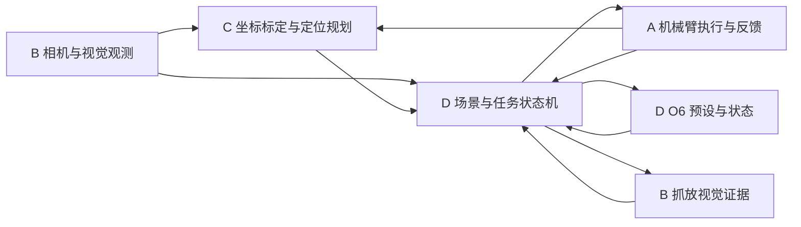

# 灵巧手垒砖砌筑真机系统设计方案

> **版本：v0.3 / 2026-11-09 / 团队评审稿。** 为保持已有引用，入口沿用文件名 `BRICK_STACKING_REAL_ROBOT_DESIGN_v0.2.md`，正文版本以本行为准。原 v0.2 完整存档见 [历史原稿](docs/design_history/BRICK_STACKING_REAL_ROBOT_DESIGN_v0.2_original_20261105.md)。
>
> 当前建设范围：**阶段一单臂单块自主抓放；阶段二单臂自主完成4+3+2+1十块结构**。设备是双臂，不等于本期实现双臂协作。本文件为需求和设计，不是已完成验收的声明；不触发设备配置或动作。
>
> 独立真机工程：Rabokit 仿真项目仅为经审查的参考案例，不作为代码基础、接口事实或真机验收依据。未知参数保持 `null/TBD`，默认 `dry_run=true`。

## 0. 修订依据、状态和适用边界

本次主要依据用户提供的 `brick_stacking_project_handoff_20261107.zip`，审阅并保留了以下原始资料：[总体计划](docs/design_sources/handoff_20261107/team_plan/docs/TEAM_PLAN.md)、[硬件接口审计](docs/design_sources/handoff_20261107/interface_audit/HARDWARE_INTERFACES.md)、[公共契约](docs/design_sources/handoff_20261107/team_plan/docs/CONTRACTS.md)、[合并计划](docs/design_sources/handoff_20261107/team_plan/docs/MERGE_PLAN.md)、[验收建议](docs/design_sources/handoff_20261107/team_plan/docs/ACCEPTANCE.md)、[落库原则](docs/design_sources/handoff_20261107/REPOSITORY_INTEGRATION.md)。逐文件及原始包 SHA256 见 [来源清单](docs/design_sources/handoff_20261107/SOURCE_MANIFEST.json)。仅保留资料，不执行包内探针或文档操作命令。

证据分类必须逐字段保留：`real_measured`（有实测记录）、`official_sdk`（源码/文档能力）、`team_reported`（团队提供）、`proposed`（建议）、`unknown`（待核实）。SDK存在、Mock通过、单次实机成功、整场能力验收四者分别记录。

日期边界：硬件表是2026-11-07审计快照，不是2026-11-09重新连接检查。后续现场变化以具名设备、采集时间、配置版本和证据更新，不能将某次canN或USB节点号永久固定。文中后续开发进度单独注明，不反写审计历史。

当前“暂不测试”只限制本轮执行：本次仅修改文档，不运行软件测试、不连接设备。后文测试均为后续计划，不是本轮已完成动作。

## 1. 目标、规则与两阶段范围

### 1.1 目标与规则来源

对象为团队提供的约50mm漆面木质立方体，真实边长、公差、质量、摩擦及桌面尺寸待测。目标是4+3+2+1共10块的**四层等腰阶梯式结构**，不是任意三维金字塔或多排堆积。

交接包只有规则第105页的一页摘录，能支持结构、由下至上红4/黄3/蓝2/绿1、原则上下层后上层、允许自主或遥控并赛前申报等信息；项目选择全自主不等于规则要求所有队伍自主。摘录在约400mm相关语句处截断，不能据此生成完整工作区尺寸。颜色错误可能影响规则得分，但本项目默认严格配色；放宽颜色须独立配置并经完整规则确认。

完整任务时间、几何容差、最终稳定时长、工作台和详细评分仍待完整规则。旧讨论中的5分钟、XY20mm/Z15mm、3秒不写成官方要求，也不作为可直接启用的默认值。`rules` 配置逐项记录 `value/source_page/status`，未知时限为null；此时只报告耗时，不声称满足赛时。

### 1.2 阶段范围

|阶段|交付目标|本期不包含|
|---|---|---|
|一|限定区域、固定目标先行，再视觉定位单块抓取—搬运—放稳—撤离复检|双臂交接、运动中视觉伺服、释放后推挪|
|二|单臂十块任务、层序/支撑验证、有界恢复、多轮无人工试跑|双臂并发、三机稠密融合、端到端学习|

主臂由团队以可达性、状态与安全证据确认，不通过代码默认选择。交接包时主臂尚未定；2026-11-09已查阅的C交接随后记录用户选择左臂，该事实需在运行配置与A/D交接中追溯，不能据此推断另一侧已安全停放。两阶段默认头部相机；只有误差预算显示必要时接入当前所选侧腕机。

### 1.3 自主与辅助统计

开发测试可安全停止后人工调整，标记 `TEST_ASSISTED`；自主试验或比赛启动后不逐动作等人确认，正常决策与有界恢复由系统执行。人工扶正、补抓、复位单独计数，不算无人工完整成功。安全急停不是自主恢复。完整比赛规则取得前不宣称已获赛事合规验收。

## 2. 硬件、软件与部署事实

### 2.1 身份快照（2026-11-07）

|角色|审计时通道/位置|身份|已证实与边界|
|---|---|---|---|
|右O6|can0 / 0x27|LHO6-04-276-R-Z-1-D，固件原始C2 03 00 02|身份/六通道回应；非抓握性能验收|
|左O6|can1 / 0x28|LHO6-04-322-L-Z-1-D，固件原始C2 03 00 04|同上；左右固件不同|
|左臂P7协议布局|can2|J1—J7为61—67|七电机应答；不代表七轴运动精度通过|
|右臂P7协议布局|can3|J1—J7为51—57|同上；型号/安装几何仍需对应实物/模型证据|
|头部335L|USB 2-3.4.3|CP2L863000KL，固件1.4.60|单机取流与遮挡—恢复角色绑定|
|左腕Gemini2|USB 2-3.4.2|AY6M8630086，固件1.4.92|双向遮挡绑定；不是Gemini335|
|右腕Gemini2|USB 2-3.4.4|AY6M86300GH，固件1.4.92|同上|

旧记录中can0左/can1右已被本次身份审计更正；启动以设备身份、物理路径和实际应答联合核验。适配器序列字符串不唯一，不能按接口枚举顺序猜角色。线缆贴标与重启/重插自检仍是独立工作。

### 2.2 SDK与能力边界

- Linux实测Ubuntu24.04.5、ROS2 Jazzy、Python3.12；Windows日常开发，通过GitHub或离线拷贝同步到Linux，SSH启动Linux进程。Windows虚拟环境不能复制到Linux使用。
- 审计时Linkerbot Python0.5.4、python-can4.6.1、pyorbbecsdk2 2.1.3/底层SDK2.10.6；目录后缀不能冒充已核验源码commit，关键文件hash另存。
- ROS已安装不等于设备节点已部署。审计时仅parameter_events/rosout；臂、手、相机业务话题未在线。当前可先用Python SDK，业务核心不强制依赖ROS导入；需要时通过适配器接入Jazzy。
- 旧手ROS配置为L6且左右存在/总线设置不符，不直接启动，不就地覆盖第三方SDK。raw_u8、percent和rad分别建模，不以JointState.position字段名猜单位。
- J1—J5为A7Motor读写路径，J6/J7为MotorV2 P-T-M路径。后两轴主机连续发送、量程/增益/保持能力与前五轴不同；停止轮询、关进程、disable均不自动等于安全停止。构造/初始化也可能写模式或发Rest，不能把它当只读。
- 审计时触觉未验证；后续2026-11-08的C交接记录用户确认本机无触觉。当前设计不得用触觉API或全零矩阵推断接触。电流等条件能力也须明确单位、来源、新鲜度和物理意义，不能用扭矩百分比当Nm。

### 2.3 相机工程约束

头部原生RGB/深度640×480@15；腕机原生RGB640×480、深度640×400@15，是不同像素网格。必须空间配准/去畸变后才能共像素索引；同时到达或时间接近不能证明已配准。逐设备、逐profile读取K/D/深度尺度，拒绝复用另一台相机内外参。

审计时普通用户开流权限不足，临时root可取流；既有临时ACL只对当时节点有效，不等于部署完成。生产采用经批准的受限设备权限并用服务用户验收，不长期root运行。三机共享5Gbps上游及其他设备，单机成功不能宣称三机并发、供电或红外干扰通过。头部为默认唯一路径，不强制同时开三机。

## 3. 架构、分工和代码归属



|成员|职责与输入输出|现有目录优先复用|审查搭档|
|---|---|---|---|
|A|臂身份/状态、轨迹执行、到位/取消/停止证据|hardware/与设备执行边界|C|
|B|相机/录包、实例观测、质量/时序、视觉复检|hardware相机入口、vision/、verification/、CameraFrame/BlockDetection|D|
|C|外参/TCP/安装几何、坐标转换、抓放轨迹/碰撞|localization/、规划几何工具|A|
|D|O6/抓握预设、持物/实体ID、场景/槽位、FSM/安全门控|hardware手入口、scene/、planning/task_scheduler、execution/、app/task_runner|B|

**编号更正**：旧聊天“A视觉”对应现在的B，不再将A任务分配给视觉。B不发臂/手命令；C不另建任务调度器；D不重算另一套外参；A不把可达性规划塞入设备驱动。

团队包的camera/perception/arm建议目录不要求重建已有工程。公共models、protocols及schema增量迁移，由生产者和使用者共同审查。每人维护本模块Mock/样例；不能把所有集成和测试都交给D。两阶段各人各约10点，点数是相对复杂度而非天数；容量中约20%用于联调/修复，按实际风险重估。

## 4. 公共接口与时间契约

|类型|生产者→使用者|核心内容|
|---|---|---|
|ArmState|A→C/D|具名J1—J7、SDK索引/真实ID、q(rad)、dq(rad/s)/使能/故障可未知|
|HandState|D→C/流程|身份、六通道原值、单位/映射版本、能力有效性|
|RGBDObservation|B→B/C|SN、图像引用、原始/处理后K/D与尺度、profile、配准及时间差|
|BlockObservation|B→C/D|观察ID、相机系位置/可观测方向、颜色、尺寸来源、质量/协方差或未知|
|LocalizedBlock|C→D|变换后位置/位姿、输入TF/标定版本及有效性|
|SceneSnapshot|D→B/C|scene版本、持久实体ID、槽位/持有者/支撑与观测引用|
|GraspPreset / PlanRequest / PlanResult|D↔C|手形几何、目标、起点、轨迹/拒绝原因、碰撞/配置版本和有效期|
|VerificationEvidence|B→D|对象/阶段、PASS/FAIL/UNKNOWN、误差、图像引用、证据范围|
|ExecutionResult|A或D手→D|命令ID、实际反馈、状态、取消/失败原因|

所有样本包含sample_id、source(mock/recorded/real)、device_id、frame_id、设备时间（可null）、主机接收时间及其时钟域、epoch、validity、reason。配置和标定以不可变hash引用。

长度m、角度rad、时间s、四元数xyzw；`T_A_B`将B映射到A，列向量左乘。未知方向/协方差不能填单位四元数/全零。D草案Pose要求完整方向，而B当前仅有位置候选时保持camera_pose=null，提议position-only扩展，经C/D共同确认后升级schema，不私改公共类型。

设备时钟、SDK global时间、主机墙钟、ROS时间、monotonic均须显式区分。跨主机/进程重启不得直接比较monotonic；记录boot/session epoch。腕图像需曝光时刻关节插值/TF，不能用latest或到达时刻替代。RGB-D配对差和设备—主机映射误差界未知则保持UNKNOWN。receive-to-output仅为接收后延迟，不等于曝光端到端延迟。

有效期、最大配对差、图像/关节/TF年龄基于实测和任务风险共同冻结；未配置禁止真实执行。重连、逆序、配置或安装变化令旧帧/计划失效。接口建议方法沿用包内契约：A read_state/execute_trajectory/cancel，B get_observation/detect_blocks/verify/replay，C localize/plan_pick_place/validate_plan，D管理任务与手预设。名称是项目建议，不声称厂商API已存在。

## 5. 统一坐标与可追溯标定

逻辑坐标保留world、table、active_arm_base、active_tcp、head_color_optical及可选腕机。运行时映射到具名左右坐标，唯一TF/变换源由C维护。单臂可将world显式锚定到已选择基座，但必须配置声明及验证，不能默默令两者等同。

`T_world_block = T_world_camera @ T_camera_block`；仅有点时输出点，不伪造完整位姿。腕机链为 `T_world_base @ FK(q,t) @ T_flange_camera @ T_camera_block`。投影前明确去畸变/配准，深度为optical Z(m)，表面点不自动是积木中心。

局部桌面可以逐帧估计平面/工作区域，但单平面并不能确定唯一平面内原点与方向。必须有约定锚点、轴向和版本；相机或桌面运动后区分局部几何重新估计与基座外参失效。视觉建立“虚拟坐标系”不能替代机械臂基座、TCP、安装变换和时间标定。

标定分别管理：各相机内参/配准/尺度、头机到所用参考系、可选腕机到法兰、基座安装、工具TCP、抓后持物 `T_tcp_block`。放置TCP目标为 `T_world_block_target @ inverse(T_tcp_block)`。无可靠持物偏移时不假设永不滑移。

标定结果至少区分CANDIDATE、FIT_ONLY、INDEPENDENTLY_VALIDATED、INVALID，并保存实际项目状态原文。拟合残差、独立物理误差、重复性分开统计，不把标定块偏移当抓握TCP。2026-11-09已读C分支580b2fe的C35为用户接受的10mm拟合门槛、状态OPERATOR_ACCEPTED_FIT_ONLY，独立验证未做、时间误差界未知；尊重不追加独立标定姿态采样的决定，不追认全部链路已验收。安装/分辨率/工具改变使相关标定重新核对。

## 6. 视觉算法、在线处理与复检

### 6.1 桌面与实例

头部RGB-D→质量检查→桌面多平面/有效支撑区域→颜色/高度候选→轮廓/接缝及尺寸先验→三维候选与歧义→C定位→D关联。不强制固定像素ROI；固定ROI只作为具名实验profile。HSV、光照、反光、无效深度独立诊断，自动适应有边界，不能声明任意条件均准确。

同色紧贴可结合真实接缝、角点、深度/高度、尺寸与历史。长度除边长只能提供计数假设，必须有图像或几何证据支持；均匀无缝区域保持AMBIGUOUS，不能按预期十块强拆。尺寸先验与实测尺寸来源分开，拒绝率和误检/漏检分别报告。位置注明顶面/中心估计方式；立方体方向按90度对称处理。

B提供短期关联线索，D持有实体ID和场景唯一状态。颜色不是唯一ID；完全遮挡不是消失。高度图记录可见面和遮挡，不能凭顶面图证明隐藏接触与底层支撑。

### 6.2 在线最新帧框架

一个相机采集所有者，处理完整已配准RGB-D对；有界待处理队列只保留最新项，检测前后均检查年龄，异常/重连/配置变化不重放旧结果。结果绑定实际输入帧和图像引用。输出延迟、覆盖/拒绝帧、无效深度、异常类型；慢算法不靠无限排队维持“每帧都处理”。

启动至少预热并检查RGB稳定，稳定后才保存正式样本；这是已实现采集策略，不保证局部照明或所有场景。后续速度目标在B/C/D冻结后验收，不把相机15Hz当识别15Hz。运动中视觉伺服本期不做；必要腕观测先停稳、确认反馈、采集、校验、小步规划，每步仍由控制团队执行。

### 6.3 抓放证据

B只返回PASS/FAIL/UNKNOWN及scope。供料区消失不能独立证明被手持；位置吻合不能证明释放、稳定、支撑或事务成功。关联、清晰可见、相机几何版本必须有来源。前后帧需同一有效上下文和递增时间；相机/桌面变化、遮挡、歧义或过期则UNKNOWN并重新观察。

D联合A反馈、O6状态、C几何与B视觉证据作事务提交。手撤离后多帧稳定证据与最终静置时长分别配置。不可观测时不强行放行，不把固定下探高度当接触证据。

## 7. 目标槽位、支撑与规划

以实测边长a、桌面框架和目标轴生成槽位，四层数量4/3/2/1、底到顶红/黄/蓝/绿。无间隙居中示例 `x=(i-(n-1)/2)*a, z=(layer+0.5)*a`，y及方向由确认的工作区决定；不是硬编码路径或已验收坐标。油漆层、倒角、间隙与高度公差要进入误差预算。

每slot保存required_color、target_pose、supports、状态和证据。上层放置前对应两支撑已验证。D管理EMPTY/RESERVED/PLACED_UNVERIFIED/PLACED_VERIFIED等具体枚举的统一映射；C提供整段接近/抓取/抬升/运输/下降/释放/撤离的可达性与碰撞证据，不以终点IK替代路径检查。

碰撞模型包含臂、另一侧、手掌/手指、腕相机/线缆、桌面、已有结构和持物。安全间距、定位容差、形状不确定度分别建模。倒塌撤销受影响支撑与槽位状态，重扫受影响区域而非盲目沿旧计划继续。

## 8. 执行许可、停止与恢复

D生成短期permit，绑定设备、轨迹hash、scene/配置/标定版本、有效期；A及D手适配器各自复核。执行状态PENDING/RUNNING/SUCCEEDED/FAILED/CANCELLED/UNKNOWN，发送成功只算ACK；实际到位/持握/复检分别留证。

真实动作前必须具备：正确身份/所选侧、新鲜关节与图像、该动作使用的坐标链与TCP、关节限位/零位、腕轴跟踪、完整碰撞/退路、速度/加速度/超时来源、另一侧明确安全状态、现场人员与物理急停、唯一动作所有者。固定基座目标只需验证所用链路；接入视觉后必须追加视觉链路，不能绕过。

StopPolicy按设备区分请求已发送、反馈确认、保持能力与未知原因；停止轮询/退出/失联可能失去保持力，不能一律调用disable或盲目撤退。软件permit不能替代物理安全链。控制团队维护实机专项验收，视觉任务不操作或更改它。

失败先分类、获取新观测，再评估有界恢复；次数/时间/风险预算耗尽则按已验收策略安全终止。重启/人工干预后重新建立状态和许可，不从旧动作索引续发。故障模拟可离线，真实断电/断连不作为默认注入手段。

## 9. 单块与整场事务

`INIT → IDENTITY_CHECK → CONFIG/CALIBRATION_CHECK → READY → OBSERVE → SELECT → PLAN → PERMIT → APPROACH → GRASP → LIFT → VERIFY_PICK → TRANSPORT → PRE_PLACE → RELEASE → RETREAT → VERIFY_PLACE → COMMIT_SLOT`。

观察/规划失败→UNKNOWN/拒绝→有界重观察或重新规划；执行异常/取消未知→StopPolicy处理与状态核实→再决定是否恢复，不自动撤离。持物状态不清时禁止当空手继续下一块。

阶段一先固定点，再限定区域视觉单块；阶段二D按支撑顺序循环十块，最终结构/稳定性确认。每次锁定block/slot与配置快照，完成后才提交verified。`规划可行 != 命令发送 != 到位 != 持握 != 结构成功`。同一实体只允许一名动作负责人，即使CAN不同也不得私自并行动作；视觉与控制共享数据和预约，避免各自抢开相机。

## 10. 配置、日志与跨平台复现

沿用 `config/defaults.yaml`、`config/modes/`、`config/cameras/`、`config/vision_profiles/`、`config/robots/` 和 `calibration/`；实际文件是否存在以仓库为准，不因文档示例自动创建生产参数。示意字段不是当前schema直接可执行配置：

```yaml
project: {dry_run: true, platform: ubuntu_24_04_jazzy}
operation: {phase: single_arm_stage1, selected_arm: null}
blocks: {nominal_edge_m: 0.05, measured_edge_m: null}
rules:
  layers: {value: [4, 3, 2, 1], status: excerpt_confirmed, source_page: 105}
  colors_bottom_to_top: {value: [red, yellow, blue, green], status: excerpt_confirmed, source_page: 105}
  task_timeout_s: {value: null, status: unknown, source_page: null}
acceptance:
  max_image_age_s: null
  max_rgb_depth_delta_s: null
  placement_xy_m: null
  placement_z_m: null
  stable_hold_s: null
safety: {motion_enabled: false, max_tcp_speed_mps: null}
extensions: {handoff_enabled: false, dual_arm_parallel: false}
```

null表示待冻结，不以默认值通过校验；这是设计示意，selected_arm必须由现场选择证据填入。配置/外参/TCP/限位/模式改变不得在动作中途静默热更新。

Windows维护源码与离线算法，Linux独立安装其相机/SDK依赖；固定Python/依赖/SDK关键文件hash，按源文件同步，不复制venv。原生K/D、原始尺度和处理后K/D分别留存。每run记录commit/源码摘要、source、run_id、设备SN/profile、输入图像索引、clock/epoch、config/calibration/scene版本、目标/轨迹/命令、反馈、验证、重试/人工介入及最终结果；日志不存密码或密钥。

原始录包不混入源码提交，单独数据索引记录位置、hash、标签版本及开发/独立验证划分。历史失败不可删除或改写为成功。指标报告包括样本数、P50/P95/最大误差、延迟/拒绝率；没有绝对参考不能报告毫米级绝对精度。

## 11. 接入方式与资源所有权

优先复用Python函数/数据模型，ROS节点/Action作为可选运输层，部署前实测topic/message/QoS，禁止把建议topic写成在线事实。不要为跨模块对接先造两套模型或庞大消息生态。

所有者：C唯一坐标/标定源、D唯一任务/持物/槽位状态源、每相机一个取流源、每总线一个动作所有者。图像订阅/回放可共享，SDK直接开同台相机须预约。只读CAN轮询也有总线负载及副作用约束。lease超时不证明物理区域已空；共享资源撤销必须结合状态证据。

## 12. 仓库与协作交付

仓库为ANRUNYU/brick-stacking-real。保留现有src/brick_stacking/{hardware,models,vision,localization,verification,scene,planning,execution,app,runtime}；包内建议目录按现有结构映射，不整包覆盖README、pyproject、models或protocols。当前B适配扩展不等于公共契约已冻结。

每个任务交代码/配置、样例/Mock、说明、适当验证及已知限制；状态TODO/IN_PROGRESS/REVIEW/WAITING_FOR_MEASUREMENT/DONE。每个PR标任务ID、输入/输出版本及验收范围；不以合并代替硬件验收。公共契约破坏性变更需schema升级并同步调用方。离线PR可独立合并，真实动作开关保持关闭，不能等待四人同时完成才提交。

## 13. M0—M6合并点与验收

|点|参与/交付|放行条件|
|---|---|---|
|M0|全员契约、样例、身份快照、归属与主臂记录|单位/坐标/时间/失败语义共同确认；主臂待测不阻断纯离线工作|
|M1|A只读/Mock、B录包/检测、C几何/规划样例、D手Mock/FSM|各模块独立符合契约、无默认动作副作用|
|M2a|C主持C→A运动链|Mock先行；真实固定点前通过完整所用几何/设备安全门槛|
|M2b|B主持B→D观测/手/流程链|成功/失败/遮挡/过期/超时回放；另向C交标定输入|
|M3|四人单块闭环，B协调|固定点→限定区域视觉抓放，真实持握/放稳/撤离证据及统一run日志|
|M4|D主持离线十块任务|多块/多层/支撑顺序、遮挡UNKNOWN、失败恢复、重启不重放；无需等新增腕机|
|M5|A预约协调、C几何放行、四人执行|M3真实通过后先两层再完整四层，各层复检、持物及退路|
|M6|各成员报告、D汇总|冻结配置后多轮无人工完整运行；质量门槛事先确定，未达标保留未验收|

阶段一研发建议：先固定目标10次，再至少5个预定位置共20次视觉抓放，建议18/20首次完整成功；首次与重试结果分开，人工辅助单列。阶段二建议冻结后10轮完整自主，8轮完整十块成功作为首版研发起点。**这些是包内待共同冻结的建议，不是官方规则或现已通过的结果**。容差/位置范围/静置时间/重试上限须先配置；10mm/8mm等研发目标需C按误差预算评估，不能当设备保证。

离线/录制测试覆盖过期、错误颜色、同色混淆、抓空、放歪、遮挡、支撑失效、倒塌、取消未知及重启。第二阶段人工摆放多层结构即可开发B验证，C规划与D状态机用各生产者样例独立推进。现场动作串行预约，M2a/M2b软件回放可并行。

### 13.1 当前进度的证据边界

B截至2026-11-09已发布视觉候选分支及PR #12：89项相关离线检查通过、1项未执行；此前50帧开发回归与替换头部相机20帧稳定数据双平台回放通过，冷启动失败保留。实测定位精度、在线延迟和抓放闭环未验收；历史回放中位0.658s/1.142s不等于15Hz实时。

B后续本地观测适配、最新帧队列、前后视觉证据及9个用例为未执行草案，未推送，不能借用上述89项结果。对应Issues #7时钟、#8契约、#9在线、#10复检、#11验证集。C等成员后续状态以其具名交接/提交为准，本次不提升任何控制或标定能力验收结论。

## 14. 关键风险与待补资料

|风险/缺项|负责人/下一步|未解决时边界|
|---|---|---|
|完整赛规/评分/工作台要求|团队补第106页起完整章节及共用规则|时限/评分容差保持unknown|
|身份重启复核、权限、贴标|A/D身份，B相机|不照抄canN或USB节点，不永久root|
|腕轴跟踪/量程/保持与停止|A，C协助几何/专项分析|诊断窗口后调整工作量，不无限调参或绕过|
|头/腕时钟与配准|B提供真实数据，C核对时刻关联|不可比时钟和未知配准拒绝定位放行|
|外参/TCP/安装与持物几何|C，A/D提供真实状态/预设|fit-only不当完整几何验收|
|实例不可辨识、反光与遮挡|B|UNKNOWN并重观察，不强拆/填满数量|
|无触觉/持物滑移|D能力与B/C证据|不凭API存在、固定高度或发送成功推断接触|
|尺寸/桌面/摩擦未测|现场提供，B/C/D使用|标称先验与实际值分离|
|多层支撑/恢复|D状态、B观测、C几何|不可见不判消失，失效撤销相关verified|
|持续延迟与USB负载|B，团队预约|单机/单次通过不升级并发长测通过|

## 15. 延后扩展与参考

双臂可达性图、桌面中转交接、共享区互斥、并发与腕部精定位保留未来路线，不纳入当前M5的必交项。若单臂已覆盖任务，先比较增加一次抓放的成功率和耗时代价再立项。未来中转FSM与共享空间lease不能无条件异常释放；另一臂进入前必须确认占用与撤离。

参考入口为用户指定的linker-sim-assets、linkerbot-python-sdk、linkerhand-ros2-sdk及Orbbec SDK；具体接口以审计锁定的源码/文件hash和现场能力为准。本次未重新联网核验厂商最新资料，不把链接当已安装或已测试证据。原v0.2的更详细后续交接/算法参考保存在历史原稿，不能覆盖本版范围与新事实。

## 16. 修订记录与使用说明

v0.3：以交接包统一单臂两阶段、四人职责/M点；更正Gemini2和SN/总线快照；区分SDK/取流/角色/标定/执行验收；补时间域、position-only与停止能力；删除可误用的官方时限/稳定时长默认值；复用现有目录；补开发证据与未测试草案边界。v0.2原稿及引用源均保留哈希。

本文更新不是新的动作授权，不改SDK、设备权限、固件、控制配置或运行程序。下一次实现先核对所用模块现状、公共契约和输入证据；测试计划在获准执行后单独留证。待团队确认后可作为新版共同基线；不得用文档评审代替实机验收。
