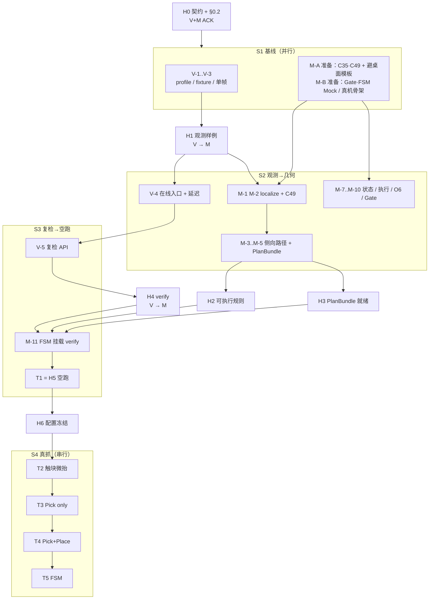
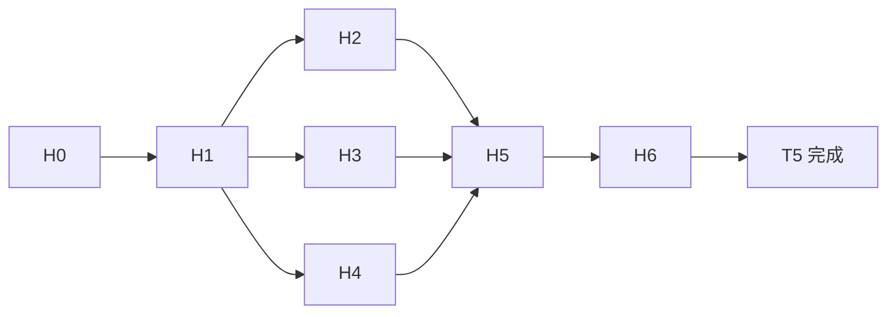

# 两线开发计划：至首次完整单块抓放

**状态**：开发规划（2026-11-10，修订为 V / M 两线；**2026-11-11** M 内人员分工见 §3.8）  
**范围**：单臂、头相机主观测、单色单块 pick → lift → place → verify。不含十块阶梯、双臂、腕相机主定位。  
**前置入口**：[PROJECT_PLAN.md](PROJECT_PLAN.md)、[CONTRACTS.md](CONTRACTS.md)、[VISION_WORKFLOW.md](VISION_WORKFLOW.md)、标定交接 [team/C/HANDOFF_20261109_CALIBRATION_COMPLETE.md](team/C/HANDOFF_20261109_CALIBRATION_COMPLETE.md)。  
**目标切片**：供料区 1 块（建议红）→ 一层目标槽 1 个；通过后方可扩展十块。

工作按 **两条线** 组织，不绑定「每人一条」：

| 线 | 范围 |
|----|------|
| **V** | 视觉观测与复检 |
| **M** | 手眼、路径规划、真机执行、安全门与单块事务（原规划线 + 原执行线） |

M 线内部仍区分「先出可审计 `PlanBundle`，再经 Gate/permit 执行」，避免边算外参边直接发运动；这是模块边界，不是第三条人员线。

---

## 0. 总原则

### 0.1 误差控制（硬规则）

1. **指标不因实现困难而放宽。** 门控数值一经 H0 冻结，联调失败时禁止用「先把容差加大」过关。
2. **实现不了先改方法，不改标准。** 允许的改法包括但不限于：
   - 改善观测条件（固定曝光、遮光、固定摆放夹具、禁止紧贴同色）；
   - 增加独立验证采样与复测；
   - 更换接近/撤离几何模板（侧向抬升、增大桌面净空路径，而非放大允许碰撞距离后仍直行下压）；
   - 增加中间确认点（空跑、微抬复检）而不降低最终误差门；
   - 推迟功能范围（例如首抓不做任意 6D 姿态），**但已承诺的定位/到位/复检误差门不变**。
3. **未知不确定度 ≠ 零。** 时钟差、外参、深度噪声未给出误差界时，禁止 `control_ready=true`，禁止签发可执行 permit。
4. **候选标定 ≠ 执行许可。** `calibration/candidates` 中 `approved=false` / `motion_enabled=false` 的 C35/C48/C49 仅供离线几何；真机执行须经现场 permit + 版本 hash 绑定（见 H5/H6）。
5. **失败默认停。** `FAIL` / 超时 / 过期观测 / 碰撞 `UNKNOWN` 且无人工监护授权 → `SAFE_HALT`；不自动盲目撤退。

### 0.2 首抓误差预算（H0 冻结，禁止私自放宽）

下列数值为**计划默认门**；H0 确认后写入配置 hash。确认前按此执行开发与测试设计。若现场物理能力不足，提交「方法变更提案」，**不**直接改大下表。

| 误差项 | 默认门（须达到） | 相关线 | 不达标时优先改法 |
|--------|------------------|--------|------------------|
| 头相机外参拟合 / 独立验证点（基座系平移） | 与 C35 策略一致：**训练拟合 ≤ 10 mm；独立验证点同样按 ≤ 10 mm 验收，不得只报拟合过、验证免测** | M | 补独立验证姿态与点；重采；检查时钟；禁止用 L5 临时块中心冒充抓点 |
| 单块顶面中心：相机系 → 基座系（相对已知尺量/夹具） | **≤ 10 mm**（平面内）；高度相对桌面 **≤ 8 mm** | V 提供观测，M 变换与对尺 | 固定夹具与曝光；重标定；拒识差深度帧；不加大 span 容差蒙混 |
| 规划法兰目标相对块（含 C49） | 几何自洽；重复持物一致性维持 C49 已记录量级；**不得用放大抓取开口代替定位精度** | M | 复检 C49 / 同 grasp_version；固定手预设 |
| 轨迹到位（关节或笛卡尔，现场冻结一种） | 低速段末端相对计划目标：**笛卡尔 ≤ 10 mm**（或等价关节门，H0 换算后写入） | M | 降速、分段、重标定零位；不放宽到位门 |
| 放置复检（槽位中心，视觉） | 相对槽位名义中心 **≤ 15 mm** 且颜色一致才允许 PASS；更大偏差一律 FAIL | V 证据，M 提交门 | 改放置接近模板、增加上方确认帧；不把 15 mm 改成 30 mm |
| 观测新鲜度 | 规划与下发瞬间：观测龄期 **≤ 已测端到端延迟上界 × 安全系数（H0 定，建议 ×2）**；当前算法约 0.7–1.1 s/帧，须实测后写入，禁止假装 15 Hz | V 测延迟，M 执法 | 降分辨率仅用于检测预览时须另开 profile，定位仍用验收分辨率；或龄期门与「块静止」夹具绑定——**不单方面放宽龄期** |
| 桌面净空 | 路径上工具/块包络相对桌面 **≥ 冻结 clearance**（建议接近段水平移动高度 ≥ 桌面 + 80 mm；闭合后先竖直抬升 ≥ 30 mm 再侧移）。此为**路径约束**，不是把碰撞阈值放宽 | M | 改 waypoint 模板；桌面盒进碰撞；路径无法满足则拒绝出包/拒绝下发 |

> 说明：上表是「完整抓取测试准入」预算。离线开发阶段可继续输出 `control_ready=false` 的诊断结果，但**不得把诊断结果标成已达上表**。

### 0.3 明确不做（首抓前）

- 以腕相机替换头相机做桌面主定位（腕眼仅可在首抓通过后作为**附加**复核，且不得放宽头相机门）。
- YOLO / 换检测骨架（除非 V 证明 HSV+几何在固定条件下无法达到上表，并提交方法变更）。
- 十块阶梯、同色紧贴必测通过、任意姿态侧抓。
- 绕过 SafetyGate；在 `approved=false` 且无现场 permit 时真机运动。

---

## 1. 两线总览

| 线 | 名称 | 核心交付 | 主要目录 | 边界 |
|----|------|----------|----------|------|
| **V** | 视觉观测与复检 | `ObservationBundle`、`VerificationEvidence`、延迟/误差报告 | `vision/`、`models/block_detection.py`、`app/tabletop_runner.py`、`app/offline_runner.py`、`config/vision_profiles/`、`tools/orbbec_camera_probe.py`、`docs/team/B/`、相关视觉测试 | 不写世界系可执行位姿；不提交槽位；不发臂/手运动 |
| **M** | 运动栈（手眼 + 路径 + 执行 + 事务） | `LocalizedBlock`/`BlockPose@base`、`PlanBundle`、真机执行、`SafetyGate`/permit、单块 FSM、T1–T5 | `localization/`、`planning/`、`calibration/`、`arm/`、`hardware/`、`execution/`、`verification/`（对接证据）、相关 tools 与 A/C/D 文档 | 消费 V 的观测与复检；不私改视觉阈值「凑抓取」；轨迹默认不可执行，须 Gate + permit |

**线间约定**

- 共享类型与 schema：`docs/CONTRACTS.md` + `src/brick_stacking/contracts/`（及 golden JSON）。跨线字段变更走 H0 变更流程。
- V → M：观测与复检证据；M → V：何种条件下观测可进入可执行链（H2），以及现场配置 hash。
- M 内部顺序：`localize` → `PlanBundle` → Gate/permit → 执行 →（调用 V.verify）→ 槽位提交。

---

## 2. 线 V — 视觉观测与复检

### 2.1 目标

在固定条件下稳定给出四色桌面候选与抓放阶段视觉证据，满足 §0.2 中观测相关门；**不**负责臂运动，**不**提交槽位成功。

### 2.2 工作内容

| 序号 | 内容 | 完成定义 |
|------|------|----------|
| V-1 | 冻结视觉 profile（头相机 SN、分辨率、`nominal_edge_m=0.05`、HSV、高度带） | 配置入 git；改动必升版本/hash |
| V-2 | 固定 fixture 数据集：稀疏单色单块、疏排四色、（记录用）紧贴同色失败例 | 清单 + 录包索引；大包可本地 artifacts，摘要进仓 |
| V-3 | 单帧检测调参：自适应桌面、连通域、接缝拆分仅在有图像证据时启用 | 独立验证集报告：漏检/误检/歧义率；**单块疏排须达到可支撑 §0.2 定位链的检测稳定**，达不到则改光照/夹具/采集，不放宽几何门 |
| V-4 | 在线入口：最新完整 RGB-D 帧对 → `ObservationBundle` | 可在机器人主机调用；含 stamp、clock_domain、camera_id、profile_hash、端到端延迟统计 |
| V-5 | 复检：`verify(phase)`，phase ∈ {pre_grasp, post_grasp, post_place} | 输出 `PASS\|FAIL\|UNKNOWN` + 图像/观测引用 + 误差；缺图或超时 → UNKNOWN（不得假 PASS） |
| V-6 | 与 M 对齐导出顶面点/中心字段；`control_ready=false` 直至 H2 规则满足 | 契约单测绿 |

### 2.3 目录与接口

- 实现参考：`vision/tabletop_segmentation.py`、`block_instance_segmentation.py`、`color_segmentation.py`、`scene_consistency.py`。
- 对外：`get_observation()` / `detect_blocks()` / `verify()` / `replay()`（语义见 CONTRACTS）。
- 交付物：报告与 golden 观测 JSON，供 M 握手（H1/H4）。

### 2.4 本线禁止

- 调用 C35 静默写「可下发」世界坐标。
- 将 `AMBIGUOUS` 强行拆成确定实例以凑数量。
- 无独立验证集时宣称「视觉已完成」。

### 2.5 本线验收（进入 H1/H4）

- [ ] 单块疏排：检测稳定，报告已归档。
- [ ] 延迟上界已实测并写入配置（非口头）。
- [ ] 复检在录包上：真阳性 PASS、故意失败场景能 FAIL/UNKNOWN。
- [ ] 未达 §0.2 时有「方法变更」记录，无擅自改大容差的 commit。

---

## 3. 线 M — 运动栈（手眼 + 路径 + 执行）

### 3.1 目标

把 V 的观测变成左臂基座系目标与避桌面轨迹，再在许可下低速执行、驱动 O6 预设、串联 V 复检，完成 T1–T5；未达门控永不假成功。

### 3.2 变换与执行链（首抓）

```text
RGB-D + BlockDetection (camera)          ← V
  --T_base_camera (C35)--> BlockPose@base
  --T_flange_block (C49)--> T_base_flange_goal
  --侧向接近模板 + IK + 碰撞--> PlanBundle (默认 motion_enabled=false)
  --SafetyGate + permit--> 真机轨迹 / O6 预设
  --V.verify--> 槽位提交或 SAFE_HALT
```

- **不使用** C35 的 `point_offset_reference_m`（L5 临时标定块）作为积木抓取 TCP。
- **不依赖** C48 作为桌面主定位；首抓路径不引用腕相机。

### 3.3 工作内容

#### A. 手眼与路径

| 序号 | 内容 | 完成定义 |
|------|------|----------|
| M-1 | `localize`：Detection + C35 → 基座系位姿；绑定标定 hash | 对尺/夹具满足 §0.2；失败则重标定/改采法，不放宽 mm 门 |
| M-2 | 接入 C49 与固定抓姿（顶面朝上；假设姿态须在 PlanBundle 声明） | 与 grasp_version / O6 预设 id 绑定 |
| M-3 | **避桌面路径模板（硬）** 见 §3.4 | 竖直下压模板必须被拒绝；合法包络 ≥ clearance |
| M-4 | IK + 低速轨迹 + 臂/手 mesh + **桌面薄盒** | 碰撞显式 `PASS` 才可申请 permit；`UNKNOWN` 不得自动变 PASS |
| M-5 | 打包 `PlanBundle`（路点、轨迹、限速、版本、碰撞摘要、有效期） | 可作为空跑/执行的唯一输入包 |
| M-6 | 外参与定位链独立验证 | 验证未做则保持不可执行 |

#### B. 执行与事务

| 序号 | 内容 | 完成定义 |
|------|------|----------|
| M-7 | 七轴 `ArmState` 可读且 `validity=VALID`（含 J6/J7） | 无效状态拒绝执行 |
| M-8 | `execute_trajectory` / `cancel` / stop；真机 port 与 Mock 分离 | 发送成功 ≠ SUCCEEDED |
| M-9 | O6：仅 `execute_preset` 已版本化开/合/抓块预设 | 与 C49 grasp_version 一致 |
| M-10 | 生产 `SafetyGate`：设备身份、标定 hash、PlanBundle hash、观测龄期、permit | 缺任一项不发 permit |
| M-11 | `PickPlaceFSM` 挂载真机 port + 调用 V.`verify` | 无 PASS 不提交槽位 |
| M-12 | 现场 runbook T1–T5 与 SAFE_HALT 原因表 | 每次运行记录配置 hash |

### 3.4 避桌面运动模板（强制）

所有抓取/放置分段必须符合下列形状（数值在 H0 写入配置；调低高度导致不满足 clearance 则拒包，不降低碰撞安全系数凑过）：

```text
安全位 / 侧方等待位
  → 目标 XY 外侧，高度 = 桌面 + approach_height     # 侧向，水平段远离桌面
  → 目标正上方，同高                                   # 水平移入
  → 抓取高度（慢速短距下探）                           # 仅最后垂直段
  → 手闭合
  → 竖直抬升至 lift_clearance                          # 先离桌，禁止未抬高就侧扫
  → 侧向移至放置接近位
放置对称：上方 → 慢降 → 张开 → 先竖直抬 → 侧撤回安全位
```

拒绝条件（须代码执法）：缺少竖直微抬或 `lift_clearance` 不足；水平段低于 `approach_height`；未加桌面碰撞体却称 `collision=PASS`；「竖直捅桌再抬」旧示教点。

### 3.5 现场阶梯（不可跳级）

| 测试 | 内容 | PASS |
|------|------|------|
| **T1** | 无块空跑整段 PlanBundle | 到位门满足；可停可 cancel |
| **T2** | 触块：下探 → 闭合 → 微抬 | 夹持不掉；仍满足 clearance |
| **T3** | Pick only | 块离桌；post_grasp 非 FAIL |
| **T4** | Pick + Place 单槽 | 复检 PASS；误差 ≤ §0.2 放置门 |
| **T5** | FSM 自动跑通同一任务 | 端到端 SUCCEEDED；日志含版本与证据 id |

任一级未过：停止下级；改方法，不放宽门控后强行 T4。

### 3.6 本线禁止

- 无 permit / 过期 permit 运动。
- 复检 UNKNOWN 当 PASS。
- 把 fit-only / `operator_acceptance` 写成已批准执行而不做独立验证。
- 用放大抓取开口或放大落点门掩盖定位误差。
- 为过 T4 私改 V 的视觉门控数值。

### 3.7 本线验收

- [ ] 基座系对尺 ≤ §0.2；PlanBundle + 避桌面单测通过。
- [ ] Mock e2e 绿；真机 port 契约测试绿。
- [ ] T1 记录完整；T4/T5 仅在 §0.2 全满足后勾选。

### 3.8 人员分工（2026-11-11）

人员交接已收成手腕目标，见 [TWO_LINE_WRIST_PLAN_20261111.md](TWO_LINE_WRIST_PLAN_20261111.md)。下表保留为当天的中间约定；字段、手指是否进路径、中间关键帧归谁，以该文件为准。误差门仍是本节 §0.2 与 §3.4。

M 仍是一条技术线（先可审计路径包，再经 Gate 执行）。人员拆开：

| 谁 | 负责 | 交付物 |
|----|------|--------|
| **本侧** | 机械臂位置标定；O6 抓取预设与路点挂载 | 命名位姿包（坐标系、完整位姿、七轴种子、可达接近方向）+ 手动作表 |
| **协作者** | 用其选定的开源 7 轴运动算法连接这些位姿 | 离线路径（关节或笛卡尔路点 + 种子）；真机使能仍走本仓 Gate |

交接契约见 [team/B/POSE_HANDOFF_FOR_PATH_20261111.md](team/B/POSE_HANDOFF_FOR_PATH_20261111.md)，方向说明见 [team/B/MOTION_STACK_DIRECTION_20261111.md](team/B/MOTION_STACK_DIRECTION_20261111.md)。

顺序固定：本侧先交出标定位姿包与手动作挂点 → 协作者离线出路径 → 空跑/dry-run → 再谈真机。`control_ready` 默认仍 false。下探路径由协作者算法生成；官方 SDK 留作读姿态与日后关节下发适配。

---

## 4. 握手点

### 4.1 一览

跨线握手以 **V ↔ M** 为主；H2/H3 为 M 侧准入里程碑（对 V 可见规则，对执行自检）。

| ID | 名称 | 方向 | 冻结物 | PASS | 失败时 |
|----|------|------|--------|------|--------|
| **H0** | 契约与误差预算 | V+M 共定 | 本文件 §0.2 + CONTRACTS + schema_version | 双方 ACK；样例 JSON 入库 | 不开正式并行交付 |
| **H1** | 观测样例 | V → M | ≥3 组 `ObservationBundle` + 录包索引 | M 离线 localize 可跑 | V 补采/改条件，不放宽检测门 |
| **H2** | 位姿可执行规则 | M（告知 V） | 缺标定/时钟界禁止可执行 | 无版本无法申请 permit | 补测时钟/外参 |
| **H3** | PlanBundle 就绪 | M 内部门 | 含侧向模板的 golden / 实景包 | 避桌面单测绿；可进入空跑准备 | 改路径方法，不放宽 clearance |
| **H4** | 复检钩子 | V → M | `verify` 请求/响应 golden | FSM：无 PASS 不 commit | V 修复检；M 不放宽提交条件 |
| **H5** | 空跑 | M（V 见证配置） | permit + 包 hash + 标定 hash | T1 PASS | 停真机；回 M 改方法 |
| **H6** | 首抓冻结 | V+M | 当日 profile + C35/C49 + PlanBundle + permit | T4 PASS 且误差表达标 | 按 §0.1 改方法重测 |

### 4.2 开发顺序与时间流程

时间按 **S1–S4** 排列；阶段可压缩，**握手顺序不可跳**。

#### 4.2.1 阶段总览

| 阶段 | 大致窗口 | 并行重点 | 必须完成的握手 | 出口 |
|------|----------|----------|----------------|------|
| **S1 基线** | 第 1 段 | V 与 M 同时开工 | **H0** | 契约 ACK；各线骨架可推进 |
| **S2 观测→几何** | 第 2 段 | V 交样例后 M 做定位/路径；M 可并行铺执行薄层 | **H1** → **H2** / **H3** | golden 观测 + 可审计 PlanBundle |
| **S3 复检→空跑** | 第 3 段 | V 交复检；M 挂载并空跑 | **H4** → **H5(T1)** | T1 PASS |
| **S4 真抓闭环** | 第 4 段 | 现场联调 | **H6**（T2–T4）→ **T5** | 单块完整抓放 + FSM |

```mermaid
gantt
    title 两线开发时序（V / M，S1–S4）
    dateFormat X
    axisFormat %s

    section 握手与门
    H0 契约与误差门           :milestone, mH0, 0, 0
    H1 观测样例 V→M           :milestone, mH1, 3, 0
    H2 位姿可执行规则         :milestone, mH2, 5, 0
    H3 PlanBundle就绪         :milestone, mH3, 5, 0
    H4 复检钩子 V→M           :milestone, mH4, 7, 0
    H5 空跑 T1                :milestone, mH5, 8, 0
    H6 首抓冻结 T2-T4         :milestone, mH6, 10, 0
    T5 FSM                    :milestone, mT5, 11, 0

    section 线V 视觉
    V-1..V-3 profile与fixture :v1, 0, 3
    V-4 在线入口              :v4, 3, 3
    V-5 复检 verify           :v5, 5, 2
    现场见证复检              :v6, 8, 3

    section 线M 运动栈
    标定只读与避桌面模板起草   :m0, 0, 3
    执行薄层Mock与真机骨架     :m0b, 0, 5
    M-1..M-2 消费H1定位       :m1, 3, 2
    M-3..M-5 路径与PlanBundle :m2, 4, 2
    M-7..M-11 挂载执行与verify :m3, 5, 3
    T1后T2..T5                :m4, 8, 3
```



> 横轴为相对序位。`H2`/`H3` 可同窗口收口，均在 H1 之后；`H4` 可与 M 收尾并行；**H5 必须 H2∧H3∧H4**。

#### 4.2.2 两线泳道流程



#### 4.2.3 握手因果



| 箭头 | 含义 |
|------|------|
| H0→其余 | 无 ACK 不开正式交付 |
| H1→H2/H3 | 无观测样例不做可验收定位/轨迹包 |
| H1→H4 | 复检与路径可并行，共用观测 schema |
| H2∧H3∧H4→H5 | 缺一禁止空跑 |
| H5→H6→T2…T5 | 空跑未过不得触块；T2→T5 串行 |

#### 4.2.4 关键路径文字版

```text
时间 →

S1 ─────────────── S2 ────────────────── S3 ──────────── S4 ──────→
H0                 H1            H2/H3    H4      H5(T1)  H6
│                  │             │        │       │       │
V: V-1..V-3 ───────┼─ V-4 ───────┼──────── V-5 ───┼─见证──┼─见证──
                   │             │                │       │
M: 模板+执行骨架 ──┴─ M-1..M-5 ──┴─ 挂载/Gate ────┴─T1────┴─T2..T5
```

**阻塞规则**

1. M-1 被 H1 阻塞；此前仅模板、只读标定与执行骨架。  
2. T1 被 H2∧H3∧H4 阻塞。  
3. T2←H5；T3←T2；T4←T3；T5←T4 且 H6 清单冻结。  
4. 握手失败：回提供方改方法，**不**放宽 §0.2，**不**跳下游「先看效果」。

### 4.3 契约变更流程

1. 改 `docs/CONTRACTS.md` + golden + `schema_version`。  
2. V 与 M 审查 ACK。  
3. 同组更新生产者与消费者。  
4. 禁止只改一侧让另一侧追适配。  
5. 误差门放宽类变更默认驳回；须证明「改方法」不可行。

---

## 5. 交付物与目录约定

| 交付物 | 线 | 建议路径 |
|--------|----|----------|
| ObservationBundle golden | V | `tests/fixtures/` 或 `docs/team/B/evidence/` |
| 视觉延迟与检测报告 | V | `docs/TEST_REPORTS/` 或 `docs/team/B/evidence/` |
| PlanBundle + 避桌面测试 | M | `calibration/examples/` 或 `docs/team/C/evidence/` |
| 外参独立验证报告 | M | `docs/team/C/evidence/` |
| permit / T1–T5 运行记录 | M | `docs/team/A/` 或 `docs/team/D/` evidence |
| 本计划 ACK | V+M | 本文末节 |

契约与本计划变更建议 PR 前缀：`contract:` / `plan:`。

---

## 6. 风险登记与对策

| ID | 风险 | 相关线 | 对策（改方法优先） | 禁止 |
|----|------|--------|-------------------|------|
| R1 | 接近/抬升打桌面 | M | §3.4 模板；桌面盒；拒包 | 放宽碰撞阈值继续竖直下压 |
| R2 | C35 临时块中心当 TCP | M | 抓取只用 C49 | 混用安装偏移 |
| R3 | 外参未验证就真机 | M | H2/H5 卡 hash 与验证报告 | fit-only 当 approved |
| R4 | 图–臂时钟不对齐 | V / M | 联采测界；无界不可执行 | 未知 skew 当 0 |
| R5 | 观测过期 | V / M | 龄期门 + 块静止夹具 | 单方面加大龄期 |
| R6 | HSV 光照漂 | V | 固定曝光/罩光/夹具 | 放宽颜色门串色仍 PASS |
| R7 | 同色紧贴 | V | 首抓禁止该场景 | 强行拆块 |
| R8 | orientation 未知 | M | 固定顶视抓姿 | 乱腕冒充 6D |
| R9 | J6/J7 无效 | M | 未 VALID 不 H5 | Mock 冒充真机 |
| R10 | 手滑移 | M | 绑定预设；微抬后调 V 复检 | 张大口盲抓抵消位姿误差 |
| R11 | 线间接口漂移 | V+M | H0 变更流程 | 私有字段对接 |
| R12 | 定位差几～十几 mm | V / M | 重标定、夹具、确认帧 | **把 10 mm 改成 20 mm「先跑通」** |

---

## 7. 本机与机器人主机

| 可在开发机完成 | 必须在机器人主机 / 现场 |
|----------------|-------------------------|
| H0、V 回放调参、M 变换/路径单测、Mock FSM | Orbbec 取流、时钟联采、外参独立验证、T1–T5 |
| golden JSON、pytest、录包生成 PlanBundle | 真机轨迹、O6 预设、permit |

SSH 不可达时：先在开发机完成 H0–H4 与 Mock；现场窗口严格按 runbook。

---

## 8. 阶段节奏（可压缩，不可跳握手）

与 §4.2 一致：第 1–4 段 = S1–S4。

| 阶段 | 对应 | V | M |
|------|------|---|---|
| 第 1 段 | S1 | H0；V-1–V-3；准备 H1 | H0；C35/C49 只读 + 避桌面模板；Gate/FSM Mock 与真机骨架 |
| 第 2 段 | S2 | H1；V-4 | 消费 H1；M-1–M-5；H2/H3；推进 M-7–M-10 |
| 第 3 段 | S3 | H4 复检 | 挂载 verify；H2∧H3∧H4 后 H5/T1 |
| 第 4 段 | S4 | 现场见证复检 | H6 后 T2→T3→T4→T5 |

---

## 9. 与旧文档映射

| 本计划 | 说明 |
|--------|------|
| V | 原视觉工作（团队文档中的 B） |
| M | 原手眼/规划（C）+ 原执行/事务（A/D 相关），合并为一条工作线 |

旧 [TASK_BOARD.md](TASK_BOARD.md) 不自动算完成；本计划握手与 T1–T5 为「首次完整抓放」准入。

---

## 10. 确认

| 线 | 日期 | ACK H0 误差门不放宽 | 备注 |
|----|------|---------------------|------|
| V |  |  |  |
| M |  |  |  |

---

**文档维护**：计划变更用 PR；误差门放宽类变更默认拒绝，除非修订目标切片并在本文显式写出，而非暗改阈值。
