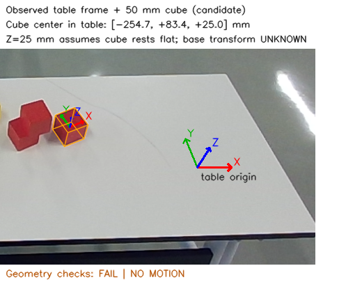

# C → A/B/D 交付入口（更新至 2026-11-09）

> **2026-11-09 最新标定收官与交接总结**：见 **[2026-11-09 标定收官与开发交接总结（C47–C49）](HANDOFF_20261109_CALIBRATION_COMPLETE.md)** 与 **[标定候选索引](../../../calibration/README.md)**。已完成头部相机外参（C35）、左腕相机外参（C48，中心 RMSE = 8.63 mm）、左爪持块抓取偏移与手势预设（C49，T_flange_block 距离 129.3 mm，consistency: PASS）三大核心真机标定，并合入 main 主分支。

**2026-11-09同步：** C代码仍在独立分支，未合并main。此前Actions失败来自CI安装OpenCV5.0缺少标定API，现将依赖限制到4.x；算法与实测结果不变。当前进展仍为头部拟合按用户10mm接受，抓取/槽位几何和Mock交接完成，实际TCP/七轴起点/完整碰撞及真机闭环待接入。

**最新C35/C36：** [6组拟合结果](C35_FIELD_SESSION.md)最大6.724mm，用户接受10mm标准；独立验证按用户要求未做。[参数](../../../calibration/candidates/C35_left_head_fit_only_user10mm_20261108.json)及[可复算输入](evidence/fixed_camera_C35_fit_inputs.json)已提供。[当前实拍场景几何](C36_SCENE_GEOMETRY.md)输出两目标基座位置、抓取候选与10槽位。C→A Mock接口3场景已联调；最后完整软件回归304通过。此后不扩大测试/哈希检查。以下早期“无外参”指当时状态；当前有用户接受的fit-only参数，实际抓握TCP/真机闭环仍未完成。

任务分支：[`codex/c-calibration-planning`](https://github.com/ANRUNYU/brick-stacking-real/tree/codex/c-calibration-planning)。本次用户明确授权上传所得成果；不合并main、不改其他成员分支、不创建Issue。历史记录中的“未推送”描述对应当时状态。

当前真实状态：主臂左P7，O6无触觉（用户确认）。已有真实RGB-D、关节读取和录制数据分析；**尚无验收通过的T_base_camera、抓握TCP或真机抓放闭环**。所有几何候选保持未批准，不提供运动许可。

先读[任务状态表](TASK_STATUS.md)、[滚动接口交接](HANDOFF_ABD.md)及[逐批输入/测试/硬件操作记录](STATUS.md)。本次完整软件回归290通过，不等于机器人验收。

## 各成员可以直接使用什么

|接收方/合并点|代码、样例与数据|限制/适配|
|---|---|---|
|A：M0/M2a/M3|[状态读取说明](LEFT_STATE_ACQUISITION.md)、五轴真实raw06反馈、`prepare_calibration_reference.py`和`associate_camera_joint_samples.py`|rad/host_monotonic/boot epoch具名；曝光插值是PROVISIONAL，五轴L5参考不冒充七轴法兰状态；IK/轨迹/碰撞分别报告|
|B：M1/M2a|[真实桌面RGB-D最小样例](../../../tests/fixtures/real/C_20261108_tabletop/README.md)、有效K、原始设备/SDK/主机时间、原图SHA、[桌面建系说明](OBSERVED_TABLE_COORDINATES.md)|裁剪是离线处理，不是545×280相机模式；内参主点已平移，光学坐标系不变；几何FAIL/时间误差界未知原样保留|
|D：M3/M4/M5/M6|[实际抓取坐标链](ACTUAL_GRASP_CALIBRATION.md)、[几何抓取候选](GRASP_CANDIDATES.md)、十槽位/分段轨迹样例及兼容BlockPose|几何抓取姿态不是已标定TCP，不是O6动作预设；整手稳定抓握、完整碰撞与实际释放仍待验证|

共同约定沿用现有模型/Protocol：m、rad、四元数xyzw；T_A_B把B坐标变到A。新增接口保持增量，不覆盖公共协议。每个方向更详细的输入/输出/版本/失败原因见HANDOFF_ABD.md。

## 最小离线复算

在独立环境安装`python -m pip install -e ".[dev]"`，FCL可选依赖/平台配置见[FCL_SETUP.md](FCL_SETUP.md)。以下不会连接硬件：

```bash
python -m pytest -q
python -c "from pathlib import Path; Path('artifacts').mkdir(exist_ok=True)"
python tools/observe_table_cube.py tests/fixtures/real/C_20261108_tabletop/camera/frame_000.npz tests/fixtures/real/C_20261108_tabletop/roi_config.json artifacts/c_review_table.json --preview artifacts/c_review_table.png
python tools/associate_camera_joint_samples.py tests/fixtures/real/C_20261108_tabletop artifacts/c_review_association.json --max-bracket-gap-s .1 --max-bracket-step-rad .01 --max-rgb-depth-skew-s .02
```

预期：桌面/红块几何检查FAIL；base变换为null；时间配对PROVISIONAL；approved/motion_enabled为false。命令成功运行与几何验收通过是两件事。采样质量参数不是运动安全限值。再次运行请选择不同输出名。



Z=25mm来自50mm方块平放模型。原始50mm尺寸不因边界检查误差而改变。图像能建桌面局部坐标，但不能单靠方块尺寸推断机器人基座位置。

## 真实数据范围与后续现场操作

仓库仅提交约1MB的最小裁剪样例与对应raw读数。裁去了无关人物区域；RGB/深度值保留，裁剪主点补偿、像素分组相位、原始文件SHA和处理来源在manifest/NPZ元数据中。未上传完整房间录像、SDK、虚拟环境、SSH凭证或整个未经逐文件审查的旧统一ZIP。

相机—左臂联合标定时，50mm块需要保持在原L5候选金属框刚性固定；可以支撑整段前臂靠近相机，单独拆块拿近不能建立base对应。若拆下或改安装，需新版本，不要求重复尺量已确认尺寸。用户只能手托，故使用短窗口曝光配对准备，不要求整段5s完全静止。当前不得自行运行硬件测试或运动脚本来“补齐”验收。

为保留各自工作目录修改，审阅者可先fetch，再在新的目录查看：

```bash
git fetch origin codex/c-calibration-planning
git worktree add --detach ../brick-stacking-C-review origin/codex/c-calibration-planning
```
